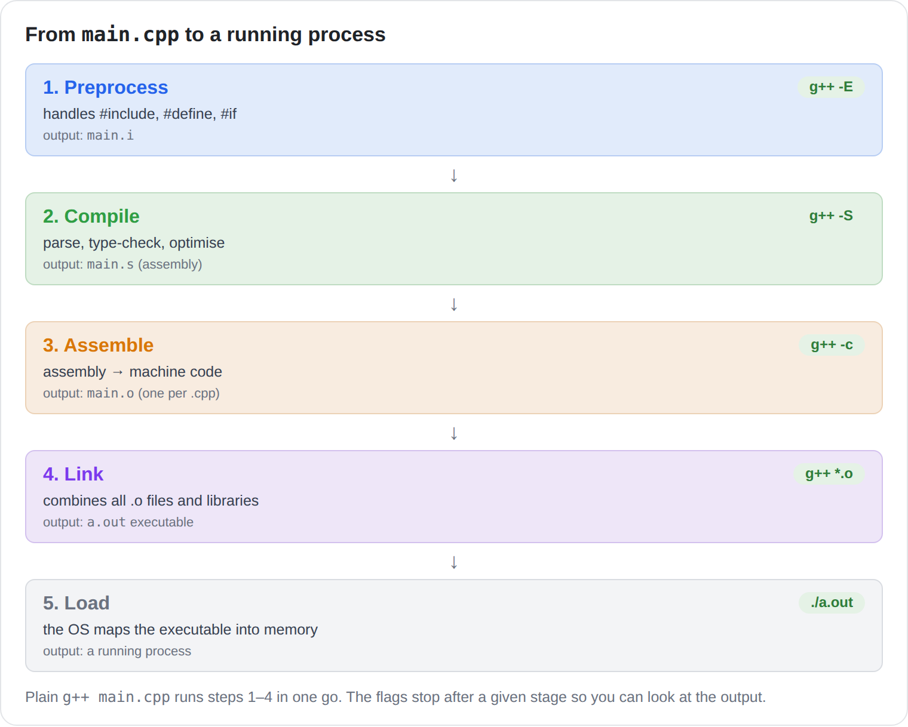
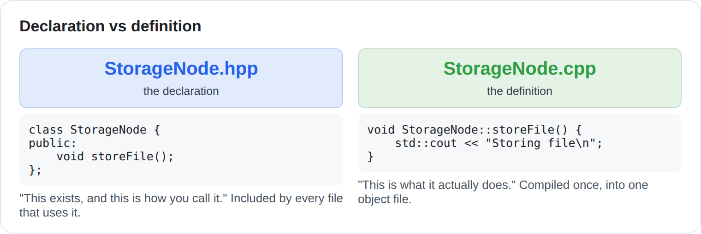
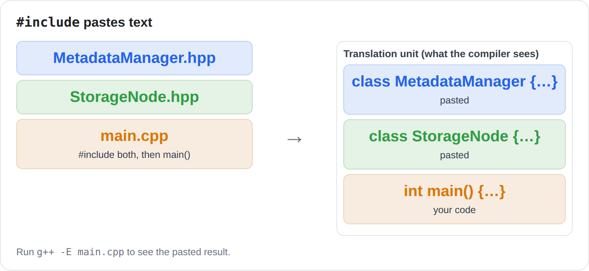
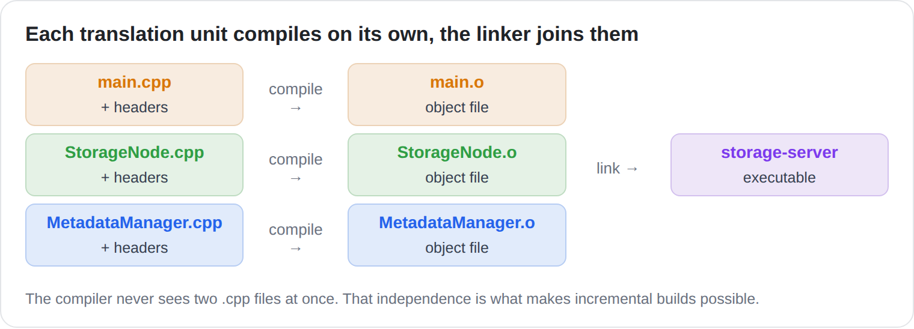
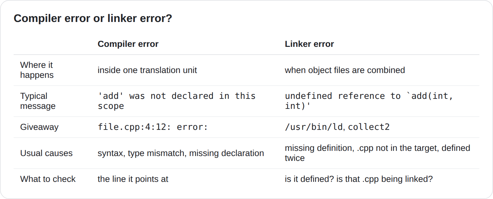
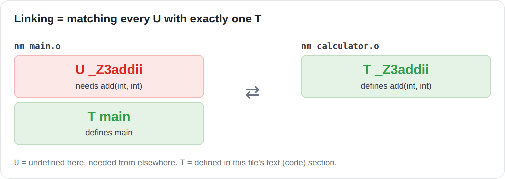
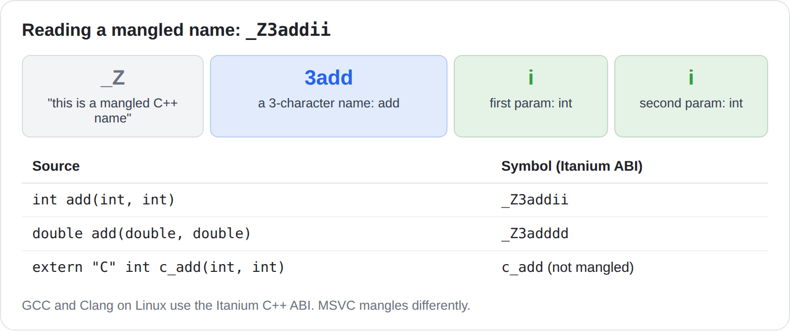
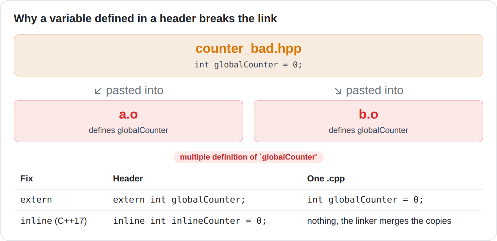
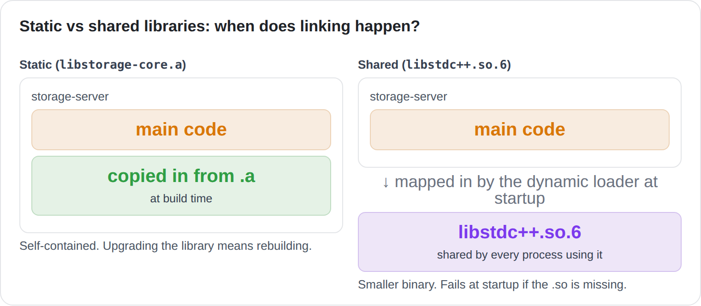
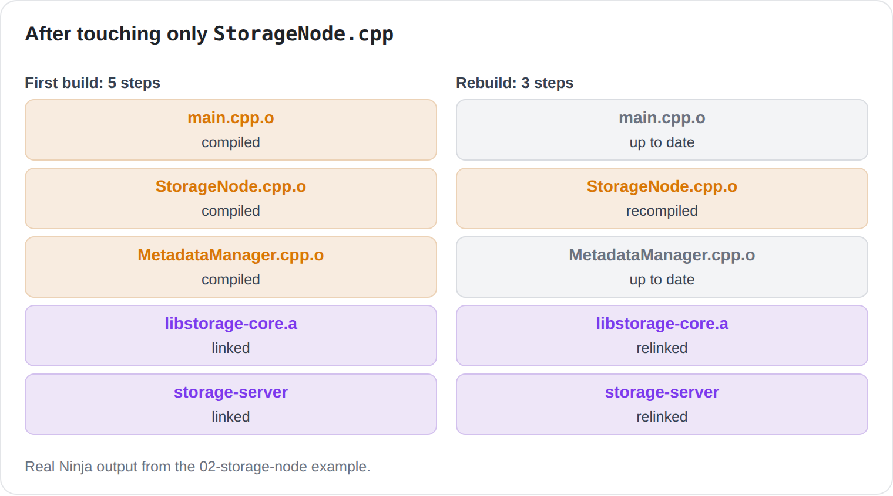

# Module 1: How C++ source becomes a running program

Before I could make sense of a real C++ codebase, I had to understand what happens between saving a `.cpp` file and running the programme. It's easy to type `g++ main.cpp` without thinking about it. But most confusing build errors start to make sense once you know which stage of the pipeline produced them.

All the code in this post is in [`examples/`](examples/). Each folder builds on its own, and the output is with GCC 11 on x86-64 Linux.

| Folder | What it shows |
|---|---|
| [`01-pipeline`](examples/01-pipeline/) | Every stage from source to executable, one command at a time, plus a compiler error and a linker error |
| [`02-storage-node`](examples/02-storage-node/) | Headers, multiple translation units and a CMake build |
| [`03-odr`](examples/03-odr/) | Breaking the One Definition Rule, and two ways to fix it |
| [`04-name-mangling`](examples/04-name-mangling/) | What overloaded functions look like to the linker, and `extern "C"` |

---

## 1. The CPU doesn't read C++

A CPU only executes machine instructions for its own architecture. An x86-64 chip runs x86-64 instructions, and an ARM chip runs ARM instructions. So C++ source has to go through a series of transformations first:



Compiling and building are different things. Compiling turns *one* source file into *one* object file. Building means coordinating many compilations, then linking, and redoing only the parts that changed. Compilers do the first job. Tools like CMake, Make and Ninja do the second.

## 2. Headers vs source files: declarations vs definitions

A typical project layout looks like this (it's the same layout as [`02-storage-node`](examples/02-storage-node/)):

```
storage-server/
├── CMakeLists.txt
├── include/
│   ├── StorageNode.hpp
│   └── MetadataManager.hpp
└── src/
    ├── main.cpp
    ├── StorageNode.cpp
    └── MetadataManager.cpp
```

The split exists because C++ separates declarations from definitions:



The declaration gives the compiler everything it needs to *call* `storeFile()`: its name, its return type (`void`) and its parameters (none). It says nothing about how the function works, so any file that wants to use `StorageNode` only needs the header.

Headers aren't strictly interface-only, though. Templates, `inline` functions and `constexpr` functions usually have their full definitions in headers, because the compiler needs to see the body wherever they're used. Keeping declarations and definitions apart is a convention, not a rule the language enforces.

## 3. `#include` is just copy-paste

`#include` isn't an import system. The preprocessor literally pastes the header's text into the file. You can see this with `g++ -E`. Here's the preprocessed `main.cpp` from `02-storage-node`, with the line markers stripped out:

```cpp
class MetadataManager {
public:
    void recordFile();
};

class StorageNode {
public:
    void storeFile();
};
int main() {
    StorageNode node;
    MetadataManager metadata;
    node.storeFile();
    metadata.recordFile();
}
```

That's why the compiler knows `StorageNode` has a `storeFile()` method while compiling `main.cpp`, even though the function body is in a completely different file.



### Include guards and `#pragma once`

If a header ends up being included twice in the same file (which happens all the time with nested includes), the class gets defined twice and compilation fails. There are two ways to prevent that, and the example uses both:

```cpp
#pragma once            // StorageNode.hpp
```

```cpp
#ifndef METADATA_MANAGER_HPP   // MetadataManager.hpp
#define METADATA_MANAGER_HPP
// ...
#endif
```

`#pragma once` is shorter and every major compiler supports it, but it isn't part of the C++ standard. Include guards are standard and work everywhere. You'll see both in real codebases.

## 4. Translation units and object files

A translation unit is one `.cpp` file after preprocessing, meaning with all its headers pasted in. This is the unit the compiler actually works on, and it compiles each one independently:



While compiling `main.cpp`, the compiler has no idea what's inside `StorageNode.cpp`. That sounds limiting, but it's what makes incremental builds possible. In a project with 5,000 source files, editing one `.cpp` means recompiling that one file and relinking, not rebuilding everything. You can watch this happen in the CMake example in section 9.

An object file is the compiler's output for one translation unit. It contains machine code, a table of symbols it defines and symbols it needs, and relocation info: placeholders saying "patch the real address in here later". Running `file` on one shows this:

```
main.o: ELF 64-bit LSB relocatable, x86-64, version 1 (SYSV), not stripped
```

*Relocatable* is the important word. It's not a program yet, because `main.o` calls `add()` but has no idea where `add()` will end up.

## 5. Compiler error or linker error?

Take [`01-pipeline`](examples/01-pipeline/):

```cpp
// main.cpp
int add(int a, int b);   // declared, not defined

int main() {
    return add(10, 20);
}
```

```cpp
// calculator.cpp
int add(int a, int b) {
    return a + b;
}
```

When the compiler sees the declaration, it knows `add` exists and takes two `int`s, so it can generate the call. It leaves a note for the linker: "fill in the address of `add(int, int)` here". The linker later finds the definition in `calculator.o` and connects the two.

Now break it in two different ways.

With no declaration at all, the compiler doesn't know what `add` is, so it stops:

```
no_declaration.cpp:4:12: error: 'add' was not declared in this scope
    4 |     return add(10, 20);
      |            ^~~
```

If the declaration is there but `calculator.o` is left out of the link, `main.cpp` compiles fine and the linker can't find a definition:

```
/usr/bin/ld: main.o: in function `main':
main.cpp:(.text+0x13): undefined reference to `add(int, int)'
collect2: error: ld returned 1 exit status
```

The giveaways are `/usr/bin/ld` and `collect2`: this error comes from the linker, not the compiler.

A compiler error comes from one translation unit: bad syntax, a type mismatch, or a name that was never declared. A linker error comes from combining object files: something was used but never defined, or defined more than once.



So when I add a method to a class and get `undefined reference`, I don't need to look at runtime behaviour or even at the call site. I check two things: does the method actually have a definition, and is the `.cpp` that defines it part of the build target?

## 6. Symbols and name mangling

The linker doesn't understand C++. It matches symbols: names in an object file's symbol table. `nm` prints them:

```
$ nm main.o
                 U _Z3addii
0000000000000000 T main

$ nm calculator.o
0000000000000000 T _Z3addii
```

`U` means undefined: `main.o` needs this symbol from somewhere else. `T` means it's defined in this file's text (code) section. Linking is mostly matching every `U` with exactly one `T`.



But why `_Z3addii` and not `add`? C++ allows overloading, so two functions can share a name:

```cpp
int add(int a, int b);
double add(double a, double b);
```

The linker needs two different names for these, so the compiler encodes the parameter types into the symbol. This is called name mangling. From [`04-name-mangling`](examples/04-name-mangling/):

```
$ nm overloads.o              $ nm -C overloads.o   (demangled)
T _Z3adddd                    T add(double, double)
T _Z3addii                    T add(int, int)
T c_add                       T c_add
```

`_Z3addii` breaks down as: `_Z` (a mangled name), `3add` (a 3-character name), then `i` and `i` (two `int` parameters). The exact scheme depends on the platform. GCC and Clang on Linux follow the Itanium C++ ABI, and MSVC uses a different one.



You can see the mangled names for yourself on [Compiler Explorer](https://godbolt.org/z/97KhPxv9f). Demangling is switched off there, so the assembly shows `_Z3addii` and `_Z3adddd` next to the plain `c_add`.

C doesn't mangle names, and that's what `c_add` is about:

```cpp
extern "C" int c_add(int a, int b) { return a + b; }
```

`extern "C"` tells the compiler to use C linkage, so the symbol is plain `c_add`. You need this whenever C++ code has to be called from C or looked up by name at runtime (for example with `dlsym`). The trade-off is that `extern "C"` functions can't be overloaded, since there's no room left in the name to tell them apart.

## 7. The One Definition Rule

Now combine sections 3 and 6. Suppose you put a variable definition in a header:

```cpp
// counter_bad.hpp
int globalCounter = 0;
```

Every `.cpp` that includes it gets its own copy pasted in, so every object file defines a `globalCounter` symbol. Each file compiles fine on its own. The linker is the first stage that sees all the copies together ([`03-odr`](examples/03-odr/)):

```
/usr/bin/ld: ...(.bss+0x0): multiple definition of `globalCounter'; ...(.bss+0x0): first defined here
```

This breaks the One Definition Rule (ODR): roughly, a variable or non-inline function used in a program must be defined exactly once across all translation units. 

There are two standard fixes:

```cpp
// Fix 1: the header only declares it...
extern int globalCounter;

// ...and exactly one .cpp defines it
int globalCounter = 0;
```

```cpp
// Fix 2 (C++17): an inline variable may be defined in many TUs;
// the linker merges them into one
inline int inlineCounter = 0;
```

The linker catches this case, but not every ODR violation. If two translation units define the same `inline` function or class *differently*, the linker typically keeps one definition without checking them against each other. The standard calls this "ill-formed, no diagnostic required". In practice it means the build succeeds and the program behaves differently depending on which definition the linker picked.

## 8. Static vs shared libraries

Large projects bundle object files into libraries. There are two kinds, and they differ in *when* the linking happens:



| | Static library (`.a`) | Shared library (`.so`) |
|---|---|---|
| What it is | An archive of `.o` files | A separately loadable binary |
| When it's linked | At build time: the needed code is copied into the executable | At load time: the dynamic loader maps it into the process |
| Upgrading it | Rebuild every program that uses it | Replace the `.so` and every program picks it up |
| Downside | Bigger binaries, duplicated code | The program fails at startup if the right `.so` is missing or incompatible |

The CMake example builds `libstorage-core.a` as a static library. Running `ldd` on the final executable shows the shared libraries it still loads at runtime, such as the C++ standard library:

```
libstdc++.so.6 => /lib/x86_64-linux-gnu/libstdc++.so.6
libc.so.6 => /lib/x86_64-linux-gnu/libc.so.6
```

## 9. Build systems: CMake, Make and Ninja

With three files you can build by hand:

```bash
g++ -c main.cpp
g++ -c StorageNode.cpp
g++ -c MetadataManager.cpp
g++ main.o StorageNode.o MetadataManager.o -o storage-server
```

With 500 files you also have to track which headers each file depends on, compiler and linker flags, external libraries, multiple outputs, and what needs rebuilding after each edit. That's what build systems are for.

CMake describes *what* to build. It doesn't compile anything itself. It generates build files for another tool. Here's [`02-storage-node/CMakeLists.txt`](examples/02-storage-node/CMakeLists.txt):

```cmake
cmake_minimum_required(VERSION 3.20)
project(StorageServer CXX)

add_library(storage-core
    src/StorageNode.cpp
    src/MetadataManager.cpp
)
target_include_directories(storage-core PUBLIC include)
target_compile_features(storage-core PUBLIC cxx_std_20)

add_executable(storage-server src/main.cpp)
target_link_libraries(storage-server PRIVATE storage-core)
```

A target is a unit of build output: here, a library (`storage-core`) and an executable (`storage-server`) that links against it. `PUBLIC` means "this applies to me *and* to anyone who links me". That's how `storage-server` gets the `include/` path and the C++20 requirement without repeating them. Real projects are split into many targets like this, not one big executable.

Make and Ninja do the actual work: they run the compiler and linker commands CMake generated, in dependency order. Ninja was designed to be fast at deciding what's out of date, which matters a lot in big projects.

```bash
cmake -S . -B build -G Ninja      # or -G "Unix Makefiles"
cmake --build build
```

The first build runs 5 steps:

```
[1/5] Building CXX object CMakeFiles/storage-server.dir/src/main.cpp.o
[2/5] Building CXX object CMakeFiles/storage-core.dir/src/StorageNode.cpp.o
[3/5] Building CXX object CMakeFiles/storage-core.dir/src/MetadataManager.cpp.o
[4/5] Linking CXX static library libstorage-core.a
[5/5] Linking CXX executable storage-server
```

Then I touched only `StorageNode.cpp` and rebuilt:

```
[1/3] Building CXX object CMakeFiles/storage-core.dir/src/StorageNode.cpp.o
[2/3] Linking CXX static library libstorage-core.a
[3/3] Linking CXX executable storage-server
```



Only `StorageNode.cpp` was recompiled. `main.cpp` and `MetadataManager.cpp` weren't touched, because each translation unit is compiled independently.

---

Next: [Module 2, types, variables and object representation](../02-types-and-object-representation/), where I look at what a C++ object actually is in memory.
