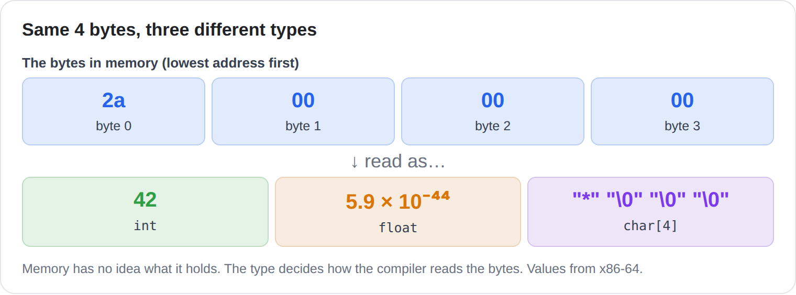
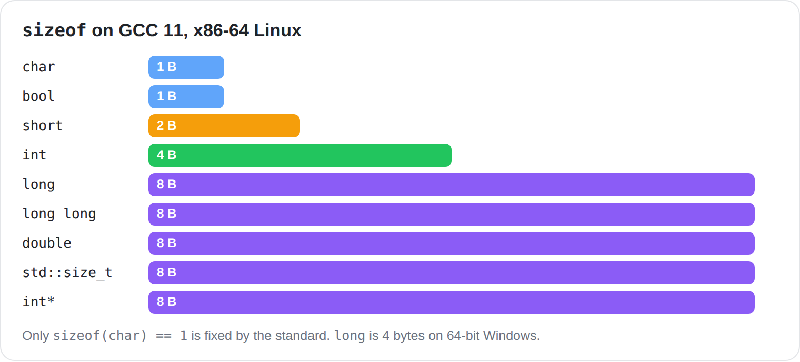
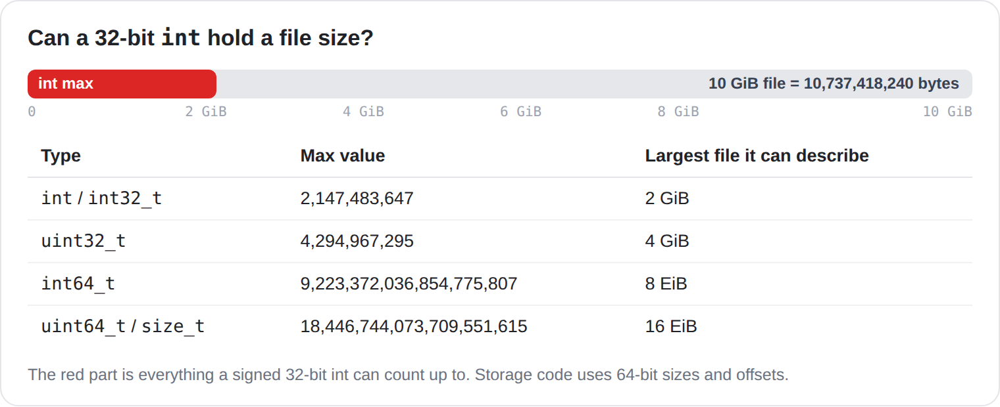
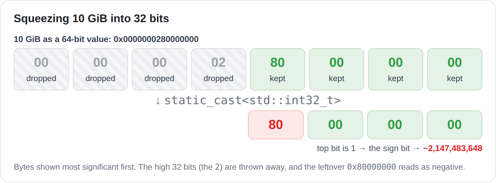
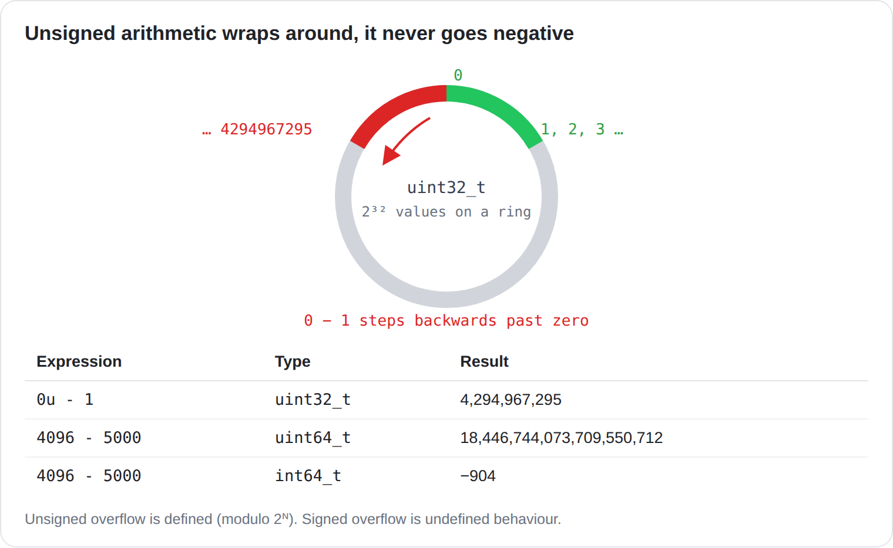
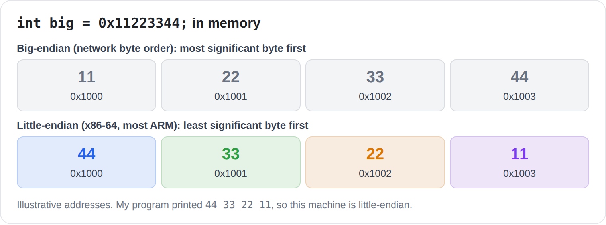
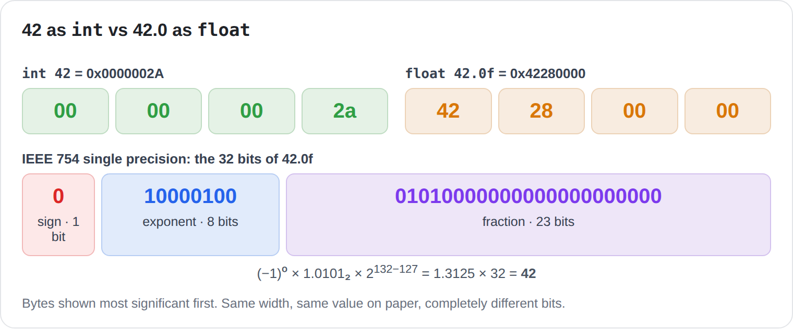
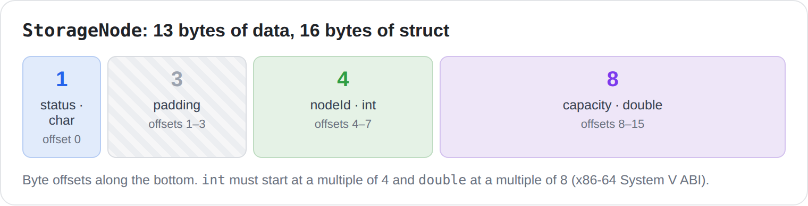
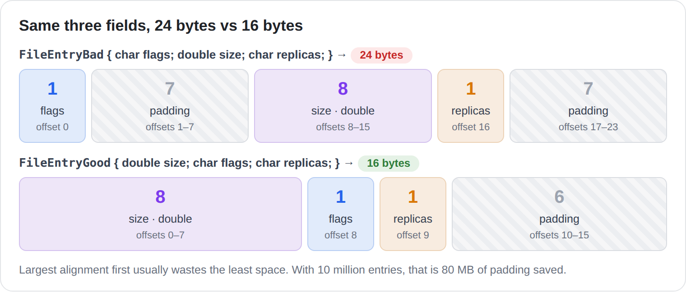
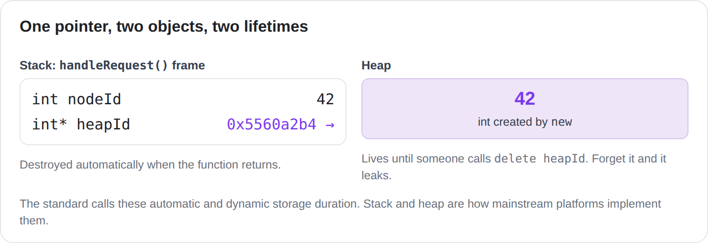

# Module 2: Types, variables and object representation

In Module 1 I followed source code until it became an executable. This module is about what the program actually stores in memory. When I write `int nodeId = 42;`, where does the 42 go, how much space does it take, and how does the machine know it's an integer and not text?

The running example for this whole phase is a storage server: a program that keeps track of files, their sizes, and which storage node holds them. Something like:

```
research-data.bin
Size: 10 GB
Storage node: 42
```

All the code is in [`examples/`](examples/). `./run.sh` builds and runs everything. The output below is from GCC 11 on x86-64 Linux. Each example also has a Compiler Explorer link, so you can run it and change it in the browser without installing anything.

| File | What it shows | Run it |
|---|---|---|
| [`sizes.cpp`](examples/sizes.cpp) | `sizeof` for the built-in types, and their ranges | [Compiler Explorer](https://godbolt.org/z/ooex7rcdT) |
| [`integer_traps.cpp`](examples/integer_traps.cpp) | A 10 GiB size squeezed into 32 bits, and unsigned wraparound | [Compiler Explorer](https://godbolt.org/z/f694dGfe7) |
| [`object_representation.cpp`](examples/object_representation.cpp) | The actual bytes in memory behind an `int` and a `float` | [Compiler Explorer](https://godbolt.org/z/qG7EMb99M) |
| [`struct_layout.cpp`](examples/struct_layout.cpp) | Padding and alignment inside structs, and when field order matters | [Compiler Explorer](https://godbolt.org/z/WfjoMKsxe) |

---

## 1. What a type is

Memory is just bytes. Nothing in RAM says "this is an integer" or "this is a file name". The type is what tells the compiler how to treat a value:

```cpp
int nodeId = 42;
double temperature = 23.5;
bool isAvailable = true;
char initial = 'E';
std::string filename = "research-data.bin";
```

From the type, the compiler knows:

- how many bytes the object needs
- how to interpret those bytes
- which operations are allowed (you can add two `int`s, but you can't add an `int` and a `std::string`)
- which machine instructions to generate. `a + b` on two `int`s becomes an integer add instruction, while on two `double`s it becomes a floating-point add.



`int`, `double`, `bool` and `char` are built into the language. `std::string` is a class from the standard library. It manages its own heap memory and has its own operations, which I'll come back to in Phase 2.

## 2. How big things are: `sizeof`

`sizeof` gives the size of a type or object in bytes. From [`sizes.cpp`](examples/sizes.cpp):

```
CHAR_BIT      8
char          1
bool          1
short         2
int           4
long          8
long long     8
double        8
std::size_t   8
int*          8

int max       2147483647
int64_t max   9223372036854775807
uint64_t max  18446744073709551615
```



These are the sizes on my machine. The C++ standard doesn't fix most of them. What it does guarantee:

- `sizeof(char)` is always 1, and a byte has `CHAR_BIT` bits, which is at least 8.
- `int` is at least 16 bits, `long` at least 32, and `long long` at least 64.
- Each type is at least as big as the one before it: `short` ≤ `int` ≤ `long` ≤ `long long`.

`long` shows why this matters: it's 8 bytes on 64-bit Linux and 4 bytes on 64-bit Windows. Code that assumes `long` is 64 bits will compile fine on Windows and then quietly overflow.

A 32-bit signed `int` holds \( -2^{31} \) to \( 2^{31}-1 \), so about ±2.1 billion. As a file size, that's 2 GiB. A storage server deals with files much bigger than that.



## 3. Picking the right integer type

When the exact width matters, `<cstdint>` has fixed-width types:

| Type | Width | Range |
|---|---|---|
| `std::int32_t` / `std::uint32_t` | exactly 32 bits | ±2.1 billion / 0 to 4.29 billion |
| `std::int64_t` / `std::uint64_t` | exactly 64 bits | ±9.2 × 10¹⁸ / 0 to 1.8 × 10¹⁹ |
| `std::size_t` | big enough to hold the size of any object | unsigned, 64 bits here |

File sizes and offsets in storage code are almost always 64-bit. [`integer_traps.cpp`](examples/integer_traps.cpp) shows what happens when they aren't:

```
10 GiB as int64:  10737418240
10 GiB as int32:  -2147483648
10 GiB as uint64: 10737418240
```

10 GiB is `0x2_8000_0000` in hex. Converting it to 32 bits keeps only the low 32 bits, `0x8000_0000`, and as a signed 32-bit number that's −2147483648. The file size isn't just truncated, it turns negative. Since C++20 this conversion is defined to work exactly this way (modulo \(2^{32}\)). Before C++20 the result was implementation-defined.



### Unsigned wraparound

File sizes can't be negative, so `uint64_t` seems like the obvious choice. But unsigned arithmetic never goes below zero. It wraps around:

```
0u - 1 (uint32):  4294967295
4096 - 5000:      18446744073709550712
```

The second line is the dangerous one. It's a "remaining bytes in the buffer" calculation where `used` was bigger than `bufferSize`. With signed types you'd get −904 and could check for it. With unsigned types you get 18 quintillion, which passes any `remaining > 0` check, and the code goes on to write past the end of the buffer.



Unsigned overflow is well defined: it wraps modulo \(2^N\). Signed overflow is undefined behaviour. The compiler is allowed to assume it never happens and optimise on that basis. Neither one is automatically safe. Pick the type based on what the value means and what the API expects, and watch out for subtraction with unsigned types.

## 4. Object representation: the actual bytes

It's tempting to picture `int x = 42` in memory as the binary written out from left to right:

```
00000000 00000000 00000000 00101010
```

That's the value in binary, but it's not how the bytes are laid out on x86-64. [`object_representation.cpp`](examples/object_representation.cpp) prints each byte of an object, starting from the lowest address:

```
42          2a 00 00 00
0x11223344  44 33 22 11
-1          ff ff ff ff
42.0f       00 00 28 42
```

- 42 is `0x2a`, and it's stored first. x86-64 is little-endian: the least significant byte goes at the lowest address. `0x11223344` makes it obvious, because it comes out as `44 33 22 11`. ARM is usually little-endian too, and network protocols are usually big-endian.



- −1 is all `ff` bytes. That's two's complement, which C++20 finally requires (before that, the standard technically allowed other encodings).
- `42.0f` takes the same 4 bytes as an `int`, but the bytes are completely different (`0x42280000`, IEEE 754 single precision). The bytes don't carry their meaning with them. The type is what gives them meaning.



The standard has precise names for this:

- Object representation: all the bytes the object occupies.
- Value representation: the bits that actually hold the value.
- Padding: bytes that are part of the object but don't hold any value. Structs have these, as the next section shows.

This is why you can't just copy a struct's raw bytes onto the network or onto disk and call it a file format. Endianness, padding and type sizes can all differ on the machine reading it back.

## 5. Structs, alignment and padding

```cpp
struct StorageNode {
    char status;
    int nodeId;
    double capacity;
};
```

1 + 4 + 8 = 13 bytes. But [`struct_layout.cpp`](examples/struct_layout.cpp) shows otherwise:

```
StorageNode: sizeof=16 alignof=8
  status at offset 0
  nodeId at offset 4
  capacity at offset 8
```

Each type has an alignment requirement: its address has to be a multiple of some number. On x86-64 Linux, `int` needs a multiple of 4 and `double` a multiple of 8. Some CPUs can't load misaligned data at all, and on the ones that can, it's slower. The platform ABI, the convention compilers on that platform agree on, fixes these numbers.

So the compiler inserts padding:



`status` takes byte 0. `nodeId` can't start at 1, so bytes 1–3 are padding. `capacity` starts at 8, which is already a multiple of 8. The struct's own alignment is 8, the alignment of its strictest member, so arrays of `StorageNode` keep every `capacity` aligned too.

### Does field order matter?

For `StorageNode`, not really. Reversing the fields still gives 16 bytes. The padding just moves to the end:

```
StorageNodeReordered: sizeof=16 alignof=8
  capacity at offset 0
  nodeId at offset 8
  status at offset 12
```

But here's a struct where it does matter:

```
FileEntryBad: sizeof=24 alignof=8        FileEntryGood: sizeof=16 alignof=8
  flags at offset 0                        size at offset 0
  size at offset 8                         flags at offset 8
  replicas at offset 16                    replicas at offset 9
```

The same three fields (`char`, `double`, `char`) take 24 bytes in one order and 16 in the other. In `FileEntryBad`, both `char`s get padded out to 8 bytes. Sorting fields from largest to smallest alignment usually minimises padding.



At scale this adds up. If a metadata cache holds 10 million entries, 8 extra bytes each is 80 MB (about 76 MiB) of padding. It also means fewer entries fit in each CPU cache line.

But I wouldn't reorder fields in production code without checking first. If a struct is part of an on-disk format, a network protocol or a library's public ABI, its layout is a contract. Changing it breaks every reader that expects the old layout.

## 6. Stack and heap, a first look

Phase 2 covers this properly, but the basic picture is needed for Module 4:

```cpp
void handleRequest() {
    int nodeId = 42;                // automatic storage: lives in this function's stack frame
    int* heapId = new int(42);      // dynamic storage: the int lives on the heap
    delete heapId;
}
```

`nodeId` is created when the function starts and destroyed automatically when it returns. The `int` created with `new` stays alive until someone calls `delete` on it.



The tricky part is that `heapId` is itself a local variable. The pointer is on the stack, and the integer it points to is on the heap. Two objects, two lifetimes. Pretty much every pointer bug in Module 4 comes from mixing those two up.

(Strictly speaking, the standard talks about automatic and dynamic storage duration, not "stack" and "heap". Stack and heap are how mainstream platforms implement them.)

---

Next: [Module 3, `const`, `constexpr`, `auto` and type conversions](../03-const-constexpr-auto-conversions/).
