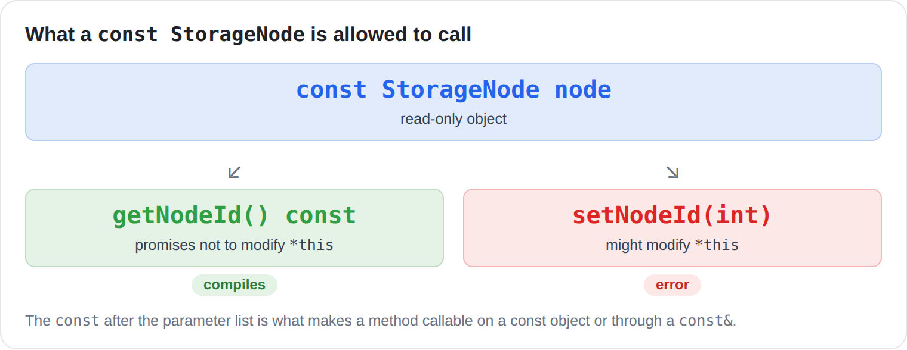
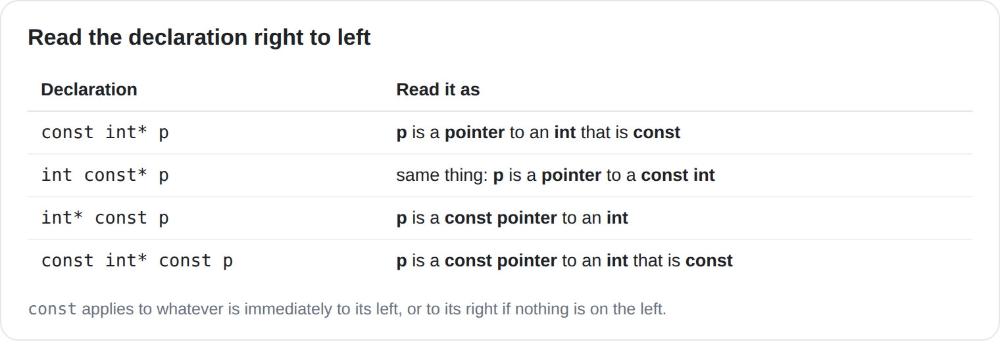
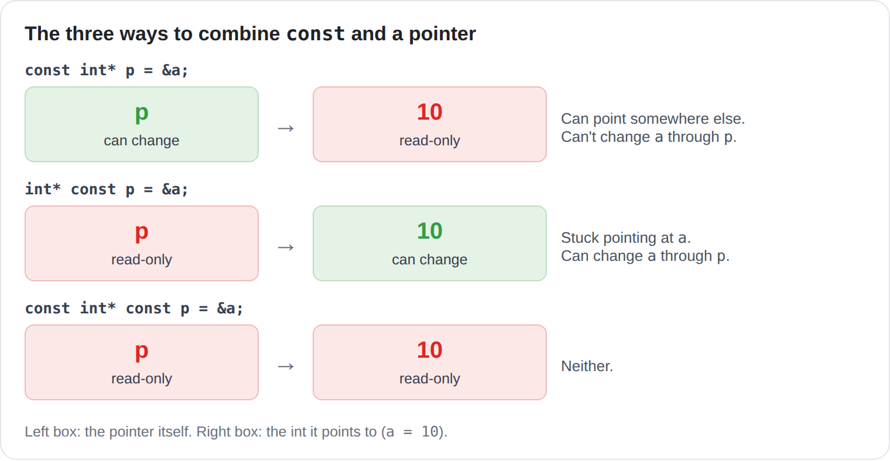
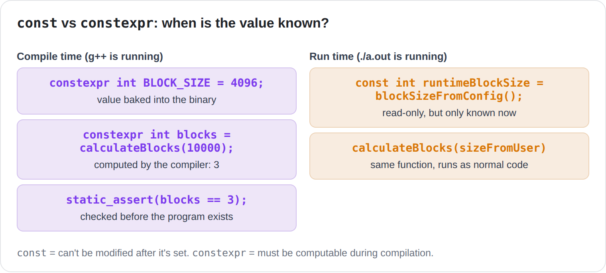
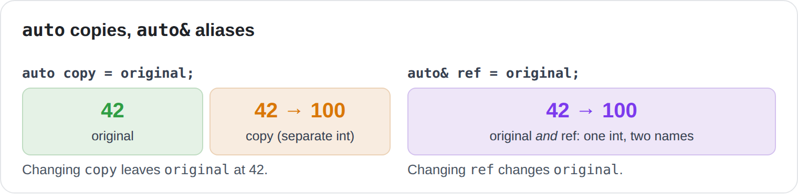
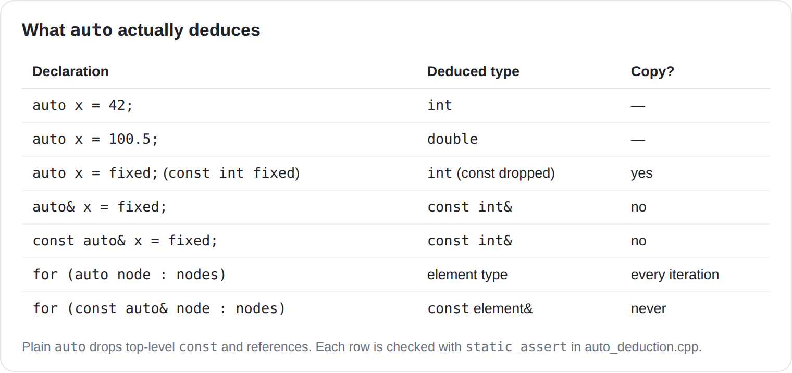
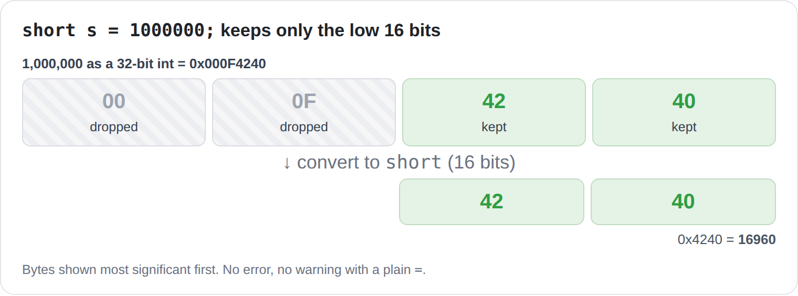
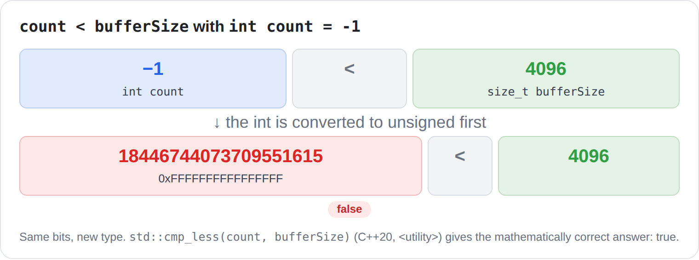
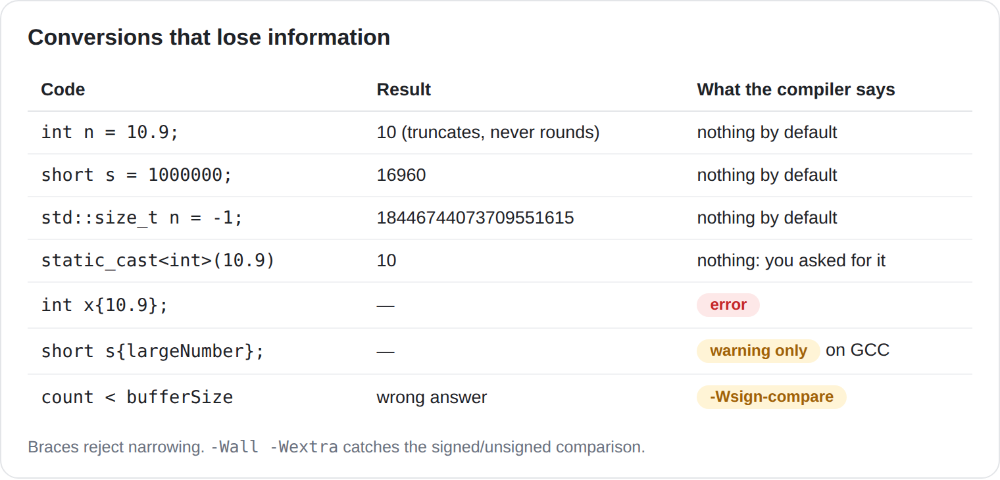

# Module 3: `const`, `constexpr`, `auto` and type conversions

These look like small features, but each one controls something the compiler can check for me: whether a value can change, whether it's known before the program runs, what type a variable really has, and when one type quietly turns into another. Most of the bugs in this module compile without errors. That's what makes them worth understanding.

All the code is in [`examples/`](examples/). `./run.sh` runs every example, then rebuilds each one with `-DSHOW_ERRORS` to turn on the lines that shouldn't compile, so you can see the real compiler errors. The output is from GCC 11 on x86-64 Linux.

| File | What it shows | Run it |
|---|---|---|
| [`const_basics.cpp`](examples/const_basics.cpp) | `const` variables and `const` member functions | [Compiler Explorer](https://godbolt.org/z/rv51nKzzY) |
| [`const_pointers.cpp`](examples/const_pointers.cpp) | The three ways to combine `const` and pointers | [Compiler Explorer](https://godbolt.org/z/zbf7614xj) |
| [`constexpr_demo.cpp`](examples/constexpr_demo.cpp) | Compile-time computation, and how it differs from `const` | [Compiler Explorer](https://godbolt.org/z/Yj3MfTK93) |
| [`auto_deduction.cpp`](examples/auto_deduction.cpp) | What `auto` deduces, and copies vs references | [Compiler Explorer](https://godbolt.org/z/aYE3eo9vY) |
| [`conversions.cpp`](examples/conversions.cpp) | Truncation, narrowing, and mixing signed with unsigned | [Compiler Explorer](https://godbolt.org/z/6Gvv3eP33) |

---

## 1. `const`: this can't be changed

```cpp
const int blockSize = 4096;
blockSize = 8192;
```

```
error: assignment of read-only variable 'blockSize'
```

More precisely, `const` means the object can't be modified through this name. That detail matters with pointers and references, as the next section shows.

It's most useful in function signatures and classes:

```cpp
class StorageNode {
public:
    int getNodeId() const { return nodeId; }
    void setNodeId(int id) { nodeId = id; }
private:
    int nodeId = 42;
};
```

The `const` after `getNodeId()` makes it a const member function: it promises not to modify the object. The compiler enforces that promise, and it's also what allows the method to be called on a `const` object:

```cpp
const StorageNode node;
node.getNodeId();     // fine
node.setNodeId(7);    // error
```

```
error: passing 'const StorageNode' as 'this' argument discards qualifiers
```

The error is hard to read, but it's saying that `setNodeId` wasn't marked `const`, so it can't be called on a `const` object. In practice this is how I'd hand a component read-only access to a node. It gets a `const StorageNode&`, and the compiler makes sure it only ever calls the read-only methods.



(Members marked `mutable` are the exception. A const member function is allowed to change them. They're mainly used for things like caches and mutexes.)

## 2. `const` with pointers

A pointer involves two things that can be const: the pointer itself, and the thing it points to.

```cpp
int a = 10, b = 20;

const int* p1 = &a;        // pointer to const int
int* const p2 = &a;        // const pointer to int
const int* const p3 = &a;  // both
```

Reading the declaration from right to left helps. `int* const p2` reads as "p2 is a const pointer to int". `const int* p1` reads as "p1 is a pointer to an int that's const".





The errors from [`const_pointers.cpp`](examples/const_pointers.cpp):

```
*p1 = 99;   error: assignment of read-only location '* p1'
p2 = &b;    error: assignment of read-only variable 'p2'
p3 = &b;    error: assignment of read-only variable 'p3'
*p3 = 99;   error: assignment of read-only location '*(const int*)p3'
```

"Read-only location" means the pointed-to value is const. "Read-only variable" means the pointer itself is.

You see the first form all over systems code:

```cpp
std::uint32_t checksum(const char* data, std::size_t size);
```

The `const char*` tells the caller that the function reads the bytes and doesn't change them. Keep in mind that `const` here only restricts this pointer. If someone else has a non-const pointer to the same bytes, they can still change them.

## 3. `constexpr`: known at compile time

`const` doesn't mean the value is known at compile time:

```cpp
int blockSizeFromConfig();                        // reads a config file at runtime
const int runtimeBlockSize = blockSizeFromConfig();
```

`runtimeBlockSize` can't change after it's initialised, but nobody knows its value until the program runs. `constexpr` is a stronger promise: the value has to be computable during compilation.

```cpp
constexpr int BLOCK_SIZE = 4096;

constexpr int calculateBlocks(int fileSize) {
    return (fileSize + BLOCK_SIZE - 1) / BLOCK_SIZE;   // round up
}

constexpr int blocks = calculateBlocks(10000);
static_assert(blocks == 3);
```

`static_assert` is checked by the compiler, so the calculation of 3 has already happened before the program exists. If I get the rounding wrong, the build fails instead of a test.

A `constexpr` function isn't limited to compile time. Called with a runtime value, like `calculateBlocks(sizeFromUser)`, it runs as a normal function. It's only guaranteed to run at compile time when the result is needed in a constant context: a `constexpr` variable, a `static_assert`, an array size, or a template argument.

Mixing the two up gives these errors:

```
constexpr int bad = blockSizeFromConfig();
    error: call to non-'constexpr' function 'int blockSizeFromConfig()'

static_assert(runtimeBlockSize == 4096);
    error: the value of 'runtimeBlockSize' is not usable in a constant expression
```

The short version:

- `const`: can this be modified after it's set? No.
- `constexpr`: is the value known before the program runs? Yes.



C++20 adds `consteval` for functions that must run at compile time, and `constinit` for variables that must be initialised at compile time but can still change later. I'll leave those for when I need them.

## 4. `auto`: let the compiler work out the type

```cpp
std::unordered_map<int, std::string> nodeNames;

for (std::unordered_map<int, std::string>::iterator it = nodeNames.begin(); it != nodeNames.end(); ++it) {}
for (auto it = nodeNames.begin(); it != nodeNames.end(); ++it) {}
```

Both loops are identical. `auto` doesn't make the variable untyped or dynamic. The compiler works out the type from the initialiser at compile time, and from then on it's fixed. In [`auto_deduction.cpp`](examples/auto_deduction.cpp) I check the deduced types with `static_assert`, so if any of them were wrong the file wouldn't compile:

```cpp
auto nodeId = 42;        // int
auto capacity = 100.5;   // double
auto available = true;   // bool
```

### Copy or reference?

This is the part that actually causes bugs. Plain `auto` always makes a copy:

```cpp
int original = 42;
auto copy = original;    // new int
auto& ref = original;    // another name for original
```

```
after copy = 100: original=42 copy=100
after ref = 100:  original=100
```



Plain `auto` also drops top-level `const` and references:

```cpp
const int fixed = 42;
auto a = fixed;          // int, not const int, since it's a copy anyway
const auto& b = fixed;   // const int&
```

That's why the usual way to loop over a container of large objects is:

```cpp
for (const auto& node : nodes) { ... }
```

With `for (auto node : nodes)`, every element would be copied on every iteration. For a vector of strings or big structs, that's a lot of hidden allocation and copying. `const auto&` gives read-only access with no copies.



## 5. Type conversions

C++ converts between types automatically in many places. Some of those conversions lose information without saying anything. [`conversions.cpp`](examples/conversions.cpp):

```
static_cast<int>(10.9) = 10
1000000 as short = 16960
-1 as size_t = 18446744073709551615
-1 is NOT less than 4096 (compared as unsigned)
```

Line by line:

Floating point to integer truncates towards zero. It doesn't round. If a block count is computed in floating point and then converted, 2.9 blocks becomes 2 and the file doesn't fit. Integer round-up, like `(size + block - 1) / block` in section 3, avoids that.

Converting to a smaller integer type keeps the low bits. 1,000,000 is `0xF4240`, and the low 16 bits `0x4240` are 16960.



`static_cast` makes a conversion visible. It doesn't make it safe. `static_cast<int>(10.9)` still gives 10. The benefit is that a reader (or a grep) can find every place a conversion was deliberate.

### Braces catch narrowing

Initialising with `{}` rejects narrowing conversions:

```cpp
int x{10.9};
short s{largeNumber};
```

```
error: narrowing conversion of '1.09e+1' from 'double' to 'int' [-Wnarrowing]
warning: narrowing conversion of 'largeNumber' from 'int' to 'short int' [-Wnarrowing]
```

The standard says both lines are ill-formed, but GCC only warns on the second one, because `largeNumber` isn't a constant. Building with `-Werror=narrowing` or `-pedantic-errors` turns it into an error.

### Signed vs unsigned

These are the last two output lines, and the most dangerous part of this module:

```cpp
int count = -1;
std::size_t bufferSize = 4096;
if (count < bufferSize) { ... }   // false
```

When a comparison mixes `int` and `std::size_t`, the `int` is converted to unsigned first. −1 becomes 18446744073709551615, which isn't less than 4096. Code that checks "is this length smaller than the buffer?" can make the wrong decision when the length is an error value like −1.



GCC warns about this, but only with `-Wall` or `-Wextra`:

```
warning: comparison of integer expressions of different signedness: 'int' and 'std::size_t' {aka 'long unsigned int'} [-Wsign-compare]
```

So I build everything with `-Wall -Wextra`. Most of the bugs in this module are things the compiler already knows about and only mentions if you ask. C++20 also added `std::cmp_less(count, bufferSize)` in `<utility>`, which compares a signed and an unsigned value correctly.

Here's every conversion from this module in one place:



---

Next: [Module 4, pointers and memory addresses](../04-pointers-and-memory-addresses/).
