# Module 4: Pointers and memory addresses

Pointers are where C++ stops hiding memory from you. They're also where most serious C++ bugs come from: crashes, corrupted data, security holes. Everything in Phase 2 (RAII, smart pointers, move semantics) exists to make pointers safer, so it's worth understanding what a raw pointer actually is first.

All the code is in [`examples/`](examples/). `./run.sh` builds and runs everything. The last three examples are deliberately broken, and the script runs each of them twice: once as a normal build, and once with AddressSanitizer. The output is from GCC 11 on x86-64 Linux. Your addresses will be different. Every example has a Compiler Explorer link. The three broken ones open with `-fsanitize=address` already turned on, so you can see the sanitizer reports in the browser.

| File | What it shows | Run it |
|---|---|---|
| [`pointer_basics.cpp`](examples/pointer_basics.cpp) | `&`, `*`, and the difference between a pointer and a copy | [Compiler Explorer](https://godbolt.org/z/MhGqndM3q) |
| [`pass_by_pointer.cpp`](examples/pass_by_pointer.cpp) | Changing a caller's variable through a pointer | [Compiler Explorer](https://godbolt.org/z/caMaG8T8b) |
| [`find_node.cpp`](examples/find_node.cpp) | `nullptr` as "not found" | [Compiler Explorer](https://godbolt.org/z/nTqjKsMcf) |
| [`pointer_arithmetic.cpp`](examples/pointer_arithmetic.cpp) | `p + 1` moves by `sizeof(*p)` bytes | [Compiler Explorer](https://godbolt.org/z/nnEY9aj5G) |
| [`dangling.cpp`](examples/dangling.cpp) | Returning the address of a local variable | [Compiler Explorer](https://godbolt.org/z/e5j1azhnx) |
| [`use_after_free.cpp`](examples/use_after_free.cpp) | Reading memory after `delete` | [Compiler Explorer](https://godbolt.org/z/oGWsP7Yxs) |
| [`leak.cpp`](examples/leak.cpp) | `new` without `delete` | [Compiler Explorer](https://godbolt.org/z/Poe4afPMs) |

---

## 1. Addresses

Memory is one long row of bytes, and every byte has a number: its address. Module 2 showed that `int nodeId = 42` takes 4 bytes. On x86-64 they're `2a 00 00 00`. The object's address is the address of its first byte.

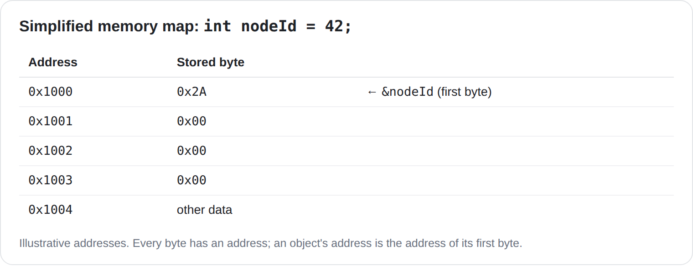

`&nodeId` gives that address. From [`pointer_basics.cpp`](examples/pointer_basics.cpp):

```
nodeId    = 42
&nodeId   = 0x7ffe33d5bff8
```

`nodeId` is the value, and `&nodeId` is where that value lives. The `0x7ffe...` prefix is typical of stack addresses on Linux x86-64. I'll get to why in Phase 4 (virtual memory).

## 2. Pointers

A pointer is an object that holds an address:

```cpp
int nodeId = 42;
int* ptr = &nodeId;
```

```
ptr       = 0x7ffe33d5bff8
*ptr      = 42
&ptr      = 0x7ffe33d5c000   (the pointer has its own address)
```

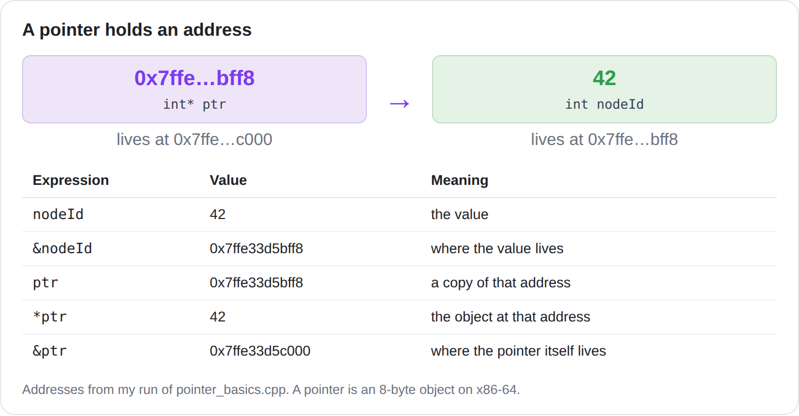

`ptr` doesn't contain 42. It contains the place where 42 is. It's also a variable in its own right, 8 bytes on a 64-bit system, with its own address.

`*ptr` dereferences the pointer: it means "the object at this address". Reading through it and writing through it behave very differently:

```cpp
int copy = *ptr;   // read: copy is a new int holding 42
*ptr = 100;        // write: changes nodeId itself
```

```
after *ptr = 100: nodeId=100 copy=42
```

`copy` took the value at that moment and has nothing to do with `nodeId` afterwards. `*ptr = 100` didn't create anything new. It went to `nodeId`'s address and overwrote it.

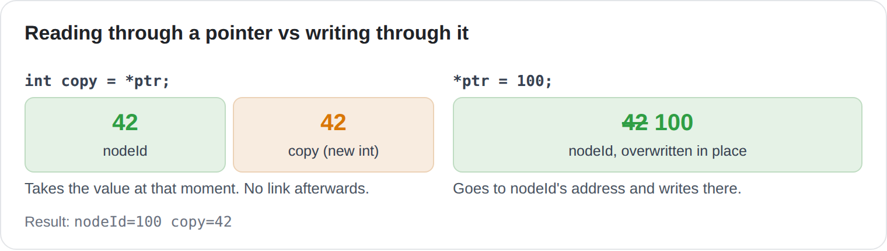

### `*` and `&` mean different things in different places

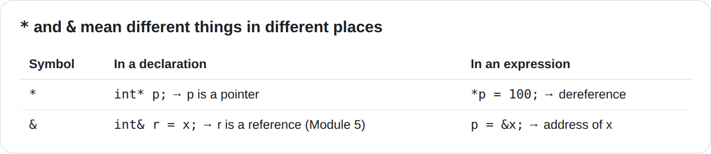

Same symbols, different meanings depending on whether you're declaring something or using it.

## 3. Why pointers are useful

Function arguments are copied by default:

```cpp
void updateCapacityByValue(int capacity) { capacity = 100; }
void updateCapacityByPointer(int* capacity) { *capacity = 100; }
```

```
after by-value:   50
after by-pointer: 100
```

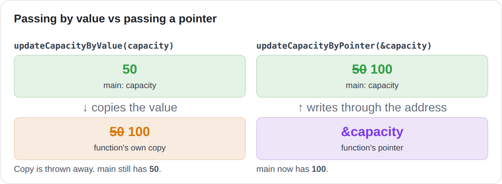

GCC even warns about the first version: `parameter 'capacity' set but not used`. Assigning to a copy that's thrown away right after is almost always a mistake.

Passing an address lets a function change the caller's object, and avoids copying large objects. For the simple "this object definitely exists, change it" case, modern C++ usually uses a reference instead (Module 5). Pointers are still the right tool when "no object" is a valid answer.

## 4. `nullptr`

`nullptr` is a pointer that points to nothing. It's the natural way to say "not found". From [`find_node.cpp`](examples/find_node.cpp):

```cpp
StorageNode* findNode(int id) {
    for (auto& node : nodes) {
        if (node.id == id) return &node;
    }
    return nullptr;
}

if (StorageNode* node = findNode(id)) {
    std::cout << node->freeGb;     // p->x is short for (*p).x
}
```

```
node 42: 800 GB free
node 5: not found
```

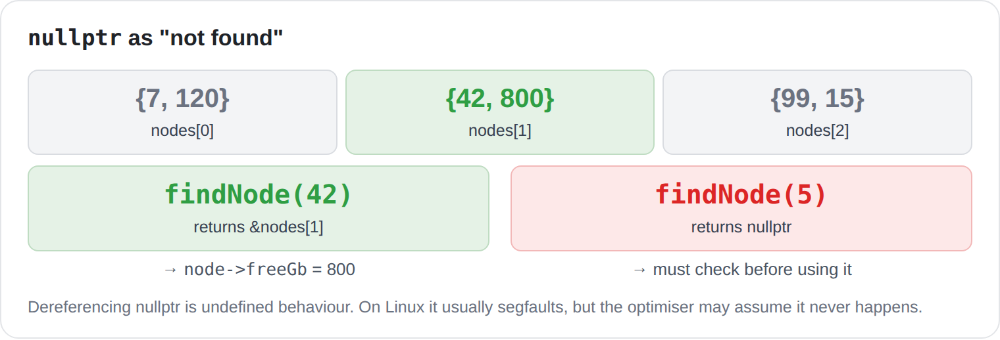

Dereferencing `nullptr` is undefined behaviour (UB): the standard places no requirements at all on what happens. On Linux the address-zero page is unmapped, so in practice you usually get a segfault. But "usually" is all you get. The optimiser is allowed to assume a dereferenced pointer can't be null, and remove later null checks based on that. Code with UB can behave differently between `-O0` and `-O2`, or between compiler versions.

## 5. Dangling pointers

A pointer can outlive the object it points to:

```cpp
int* createNodeId() {
    int nodeId = 42;
    return &nodeId;     // nodeId is destroyed when the function returns
}
```

GCC warns about it:

```
warning: address of local variable 'nodeId' returned [-Wreturn-local-addr]
```

Then the program crashes:

```
p = 0
Segmentation fault (core dumped)
```

You'd expect `p` to be some leftover stack address. It's 0. Because returning a local's address is always a bug, GCC replaces the returned address with a null pointer, so the program crashes right away instead of reading stale stack memory. The AddressSanitizer build confirms it: `SEGV on unknown address 0x000000000000`. That's GCC being helpful, not something the language guarantees. Other compilers, or the same mistake hidden behind a few more function calls, will give you a real stale address that seems to work until the stack gets reused.

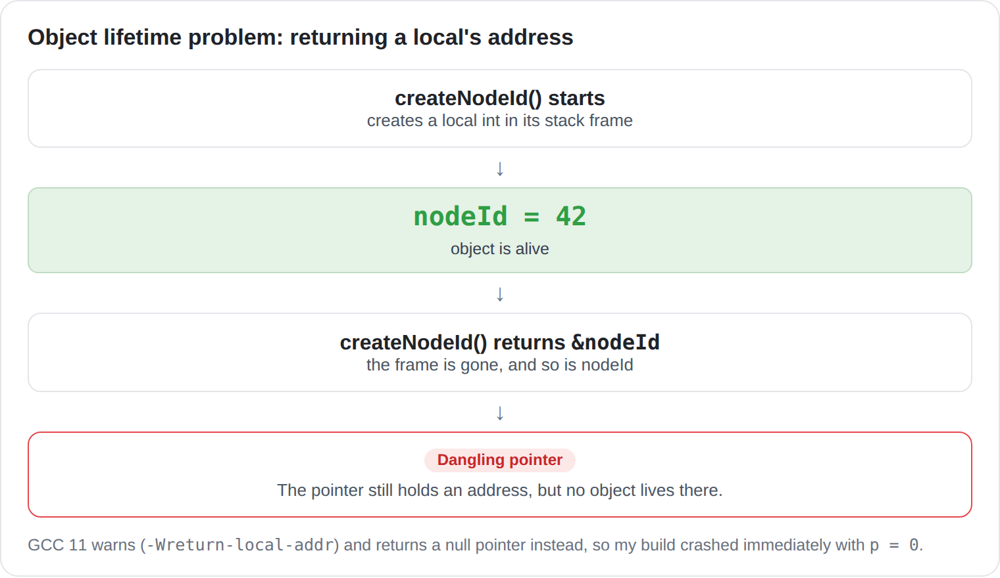

The fix is to return the value, not its address: `int createNodeId() { return 42; }`.

## 6. `new`, `delete`, and what goes wrong

`new` creates an object with dynamic storage. It stays alive until `delete`, no matter which function created it:

```cpp
int* ptr = new int(42);
delete ptr;
```

This opens the door to two classic bugs.

### Use after free

```cpp
int* ptr = new int(42);
delete ptr;
std::cout << *ptr;
```

In a normal build, this "works":

```
1971427275
```

No crash, just a garbage number. The heap allocator reused those 4 bytes for its own bookkeeping, and that's what got printed. Run it twice and you get different numbers. This is what makes use-after-free so bad in real systems: the program carries on with corrupted data, and the symptom shows up far from the cause.

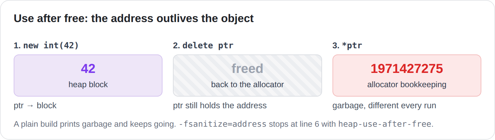

AddressSanitizer (`-fsanitize=address`) catches it immediately and points to all three lines involved:

```
ERROR: AddressSanitizer: heap-use-after-free on address 0x502000000010
READ of size 4 at 0x502000000010 thread T0
    #0 in main use_after_free.cpp:6
freed by thread T0 here:
    #1 in main use_after_free.cpp:5
previously allocated by thread T0 here:
    #1 in main use_after_free.cpp:4
```

### Leaks

```cpp
void handleRequest() {
    char* buffer = new char[1024 * 1024];
    // forgot delete[] buffer;
}
```

A normal build prints nothing. Nothing crashes. The memory is just gone. ASan's leak checker reports it when the program exits:

```
ERROR: LeakSanitizer: detected memory leaks
Direct leak of 3145728 byte(s) in 3 object(s) allocated from:
    #1 in handleRequest() leak.cpp:2
```

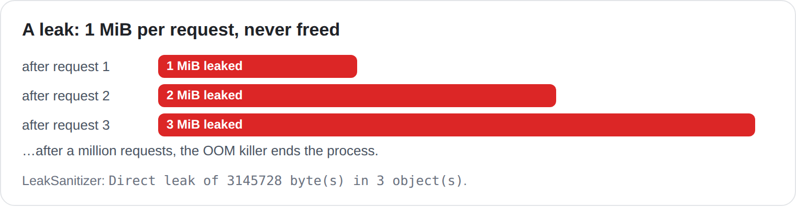

That's 1 MiB per call, times 3 calls. Now picture a storage server that handles millions of requests and stays up for months. If one error path skips the `delete`, memory grows until the OOM killer ends the process. (Arrays from `new[]` must be freed with `delete[]`. Mixing up the two forms is UB too.)

This is why `-fsanitize=address` belongs in debug builds. It found all three bugs in this module with exact line numbers. The cost is roughly 2× slower and more memory, which is fine for tests but not usually for production.

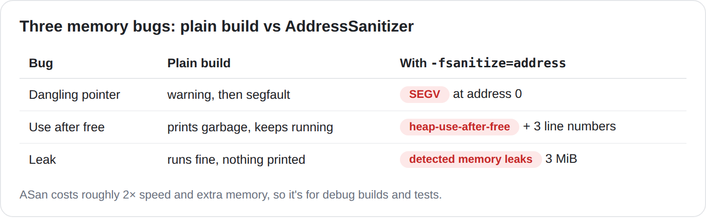

## 7. Pointer arithmetic

Adding to a pointer moves it by whole objects, not bytes. From [`pointer_arithmetic.cpp`](examples/pointer_arithmetic.cpp):

```cpp
int values[] = {10, 20, 30};
int* p = values;
++p;
```

```
p = 0x7ffefd106538  *p = 10
p = 0x7ffefd10653c  *p = 20
p = 0x7ffefd106540  *p = 30

c = 0x7ffefd106544  c + 1 = 0x7ffefd106545
```

`int*` moves by 4 bytes each time (`...538` → `...53c` → `...540`), and `char*` moves by 1. `p + n` really means `address + n * sizeof(*p)`. That's also how `values[i]` works: it's defined as `*(values + i)`.

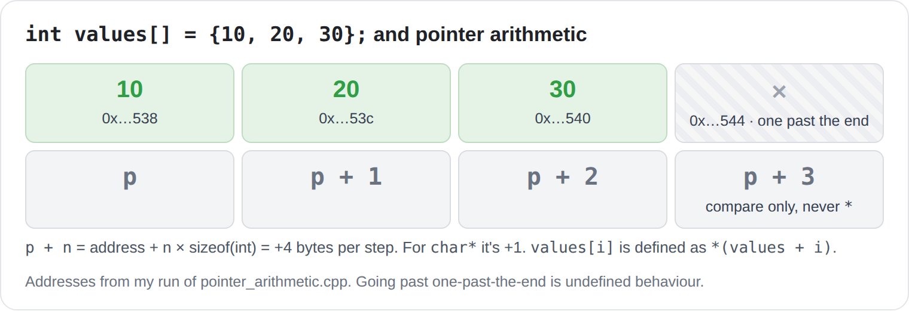

The rules are strict. Pointer arithmetic is only defined inside an array, plus one position past the end. The one-past-the-end pointer can be compared and subtracted (the example computes `p - values == 3`), but not dereferenced. Going beyond that is a buffer overflow, the same family of bug as the "4096 − 5000" unsigned wraparound in Module 2. And C++ won't stop you: raw pointers have no bounds checks.

## 8. Why this matters in a storage server

Combine these bugs with threads. One thread is reading file data into a buffer, and another thread decides the request is finished and frees that buffer. The first thread keeps writing into memory that now belongs to something else, maybe another request's metadata. Nothing crashes at the time. A checksum fails hours later, on a different file.

That's why memory safety in C++ is a reliability and security problem, not just a language detail. A large share of real-world security vulnerabilities in C and C++ code are memory-safety bugs like these. Phase 2 is about making ownership explicit, with RAII, `std::unique_ptr` and `std::shared_ptr`, so that "who deletes this, and when?" is answered by the type system instead of by convention.

---

Next: [Module 5, references and value categories](../05-references-and-value-categories/).
