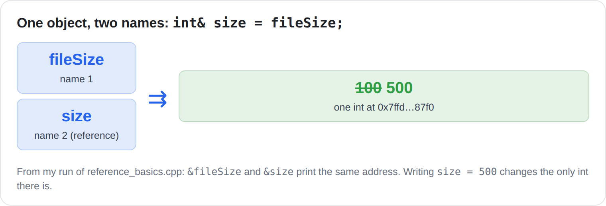
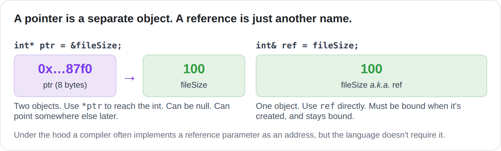
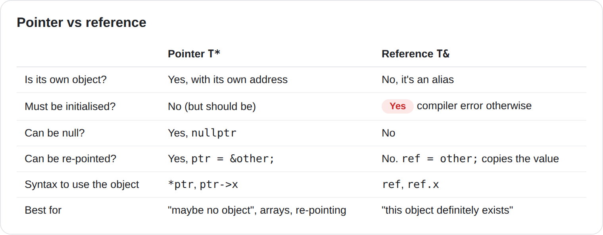
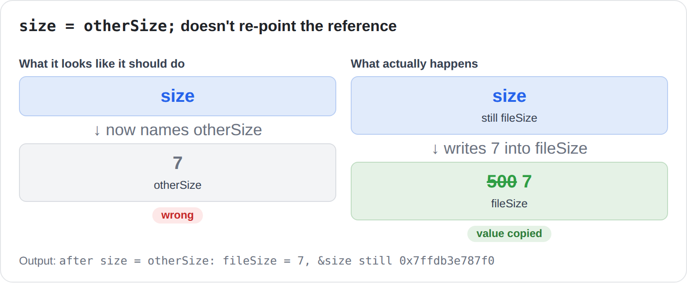
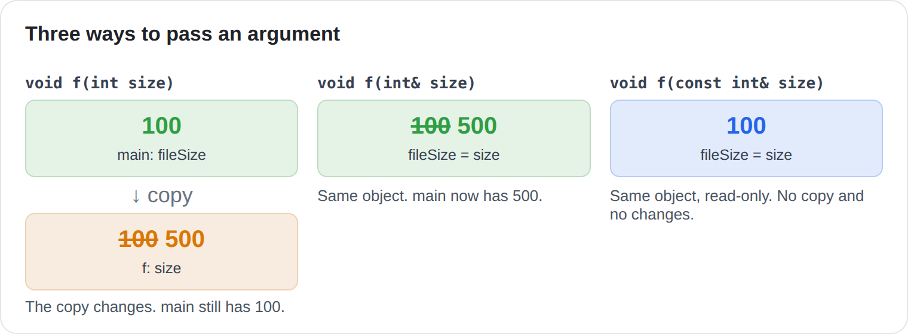
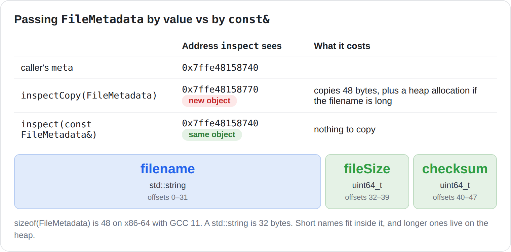
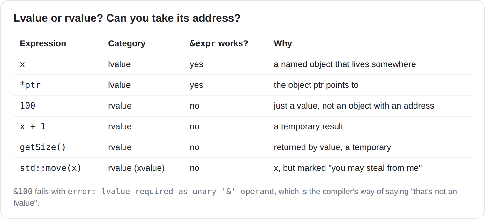
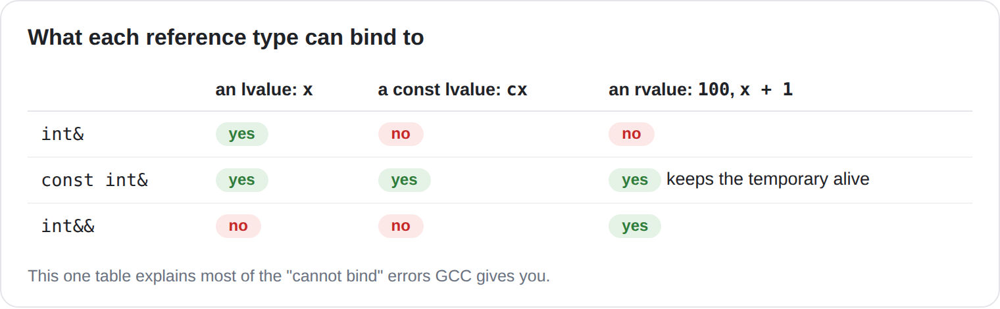
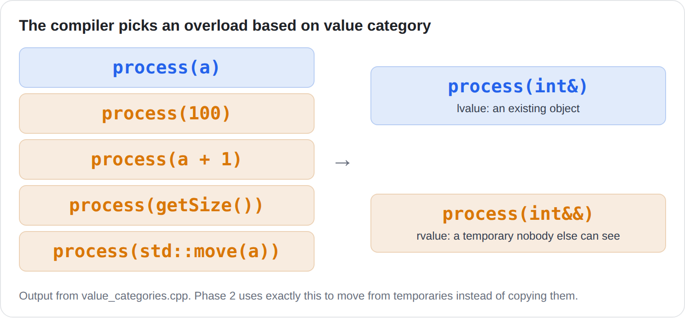
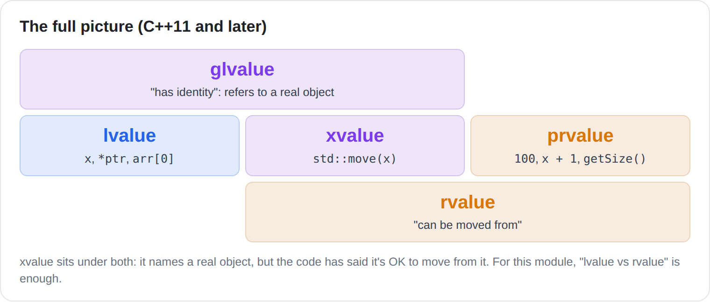

# Module 5: References and value categories

Module 4 used pointers to let a function change the caller's variable. It works, but every call needs `&` and every use needs `*`, and the pointer could always be null. References give you the same "work on the original object" behaviour with none of that. They also lead into value categories (lvalues and rvalues), which is what move semantics in Phase 2 is built on.

All the code is in [`examples/`](examples/). `./run.sh` runs every example, then rebuilds each one with `-DSHOW_ERRORS` to turn on the lines that shouldn't compile, so you can see the real compiler errors. The output is from GCC 11 on x86-64 Linux. Your addresses will be different.

| File | What it shows | Run it |
|---|---|---|
| [`reference_basics.cpp`](examples/reference_basics.cpp) | A reference is another name for the same object, and can't be re-pointed | [Compiler Explorer](https://godbolt.org/z/c818Yxan6) |
| [`pass_by_reference.cpp`](examples/pass_by_reference.cpp) | `T&` and `const T&` parameters, and what a copy costs | [Compiler Explorer](https://godbolt.org/z/EsTbMcrbW) |
| [`value_categories.cpp`](examples/value_categories.cpp) | Lvalues, rvalues, and overloading on `int&` vs `int&&` | [Compiler Explorer](https://godbolt.org/z/YEoTfvTW3) |

---

## 1. The pointer version

This is the function from Module 4, changing a file size through a pointer:

```cpp
void updateFileSize(int* size) {
    *size = 500;
}

int fileSize = 100;
updateFileSize(&fileSize);
```

The caller has to pass `&fileSize`, the function has to write `*size`, and nothing stops someone from passing `nullptr`. For "here's an object, change it", that's more ceremony than the job needs.

## 2. A reference is another name

```cpp
int fileSize = 100;
int& size = fileSize;   // size is another name for fileSize

size = 500;
```

```
fileSize = 500
&fileSize = 0x7ffdb3e787f0
&size     = 0x7ffdb3e787f0
```



There's only one `int` here. `size` isn't a copy and it isn't a pointer you have to dereference. Taking its address gives you the address of `fileSize`, because that's the object it names.

A reference has to be bound to an object when it's created, and it can't be bound to a temporary like `100`:

```cpp
int& unbound;           // error: 'unbound' declared as reference but not initialized
int& toTemporary = 100; // error: cannot bind non-const lvalue reference of type 'int&' to an rvalue of type 'int'
```

That second error is the first hint of value categories. I'll come back to it in section 5.

## 3. Pointer vs reference

```cpp
int* ptr = &fileSize;   *ptr = 500;   // pointer
int& ref = fileSize;    ref = 500;    // reference
```





The row that's easiest to get wrong is "can be re-pointed". Assigning to a reference doesn't make it name something else. It assigns to the object it already names:

```cpp
int otherSize = 7;
size = otherSize;
```

```
after size = otherSize: fileSize = 7, &size still 0x7ffdb3e787f0
```



A pointer can be re-pointed (`ptr = &otherSize;`), and that's exactly when you want one: a value that might be "nothing" or might change what it refers to. For "this object, always", a reference says that in the type.

The standard doesn't say how references are implemented. A reference parameter is usually passed as an address under the hood, but the language treats a reference as an alias, not as an object of its own. You can't have a pointer to a reference, an array of references, or a null reference.

## 4. References as parameters

```cpp
void updateByValue(int size)      { size = 500; }
void updateByReference(int& size) { size = 500; }
```

```
after updateByValue:     100
after updateByReference: 500
```



The call looks the same both ways: `updateByReference(fileSize)`, no `&`. The parameter type alone decides whether the function gets a copy or the original. GCC also warns about `updateByValue`: `parameter 'size' set but not used`, since changing a copy that's thrown away is almost always a bug.

### `const T&`: no copy, no changes

For an `int`, copying is free. For a bigger object it isn't:

```cpp
struct FileMetadata {
    std::string filename;
    std::uint64_t fileSize;
    std::uint64_t checksum;
};

void inspectCopy(FileMetadata metadata);         // gets its own copy
void inspect(const FileMetadata& metadata);      // reads the caller's object
```

```
caller:       0x7ffe48158740
by value:     0x7ffe48158770 (a new 48-byte object)
by const ref: 0x7ffe48158740 (the caller's object)
```



The by-value version builds a whole new `FileMetadata`, including a copy of the string, which means a heap allocation once the filename is longer than about 15 characters. The `const&` version sees the caller's object at the same address, and `const` means it can't change it:

```
error: assignment of member 'FileMetadata::fileSize' in read-only object
```

`const T&` for read-only parameters is probably the most common function signature in C++ codebases. Module 6 has a table of which parameter type to use when.

## 5. Lvalues and rvalues

Back to that error: why can't `int&` bind to `100`?

Every expression in C++ has a value category. The simple version:

- An lvalue names an object that lives somewhere. `x`, `fileSize`, `*ptr`. You can take its address.
- An rvalue is a temporary value with no lasting identity. `100`, `x + 1`, or a function returning by value. You can't take its address.

```cpp
int* p = &100;   // error: lvalue required as unary '&' operand
```



An `int&` promises "I refer to an existing object that you can change". Binding it to `100` would mean changing a temporary that disappears at the end of the line, so the compiler refuses. A `const int&` only promises to read, so it can bind to a temporary, and C++ keeps the temporary alive for as long as the reference exists:

```cpp
const int& limit = 4096;   // fine
```

### The three reference types

```cpp
int x = 100;
int& a = x;          // lvalue reference
const int& b = x;    // const lvalue reference
int&& c = 100;       // rvalue reference
```

`int&&` is the opposite of `int&`: it only binds to rvalues.

```cpp
int&& r = a;   // error: cannot bind rvalue reference of type 'int&&' to lvalue of type 'int'
```



### Why the distinction exists

Because the compiler can pick a different overload for each:

```cpp
void process(int& x)  { std::cout << "int&  (lvalue) got " << x << '\n'; }
void process(int&& x) { std::cout << "int&& (rvalue) got " << x << '\n'; }

int a = 10;
process(a);
process(100);
process(a + 1);
process(getSize());
process(std::move(a));
```

```
int&  (lvalue) got 10
int&& (rvalue) got 100
int&& (rvalue) got 11
int&& (rvalue) got 4096
int&& (rvalue) got 10
```



An `int&&` parameter means "you got a temporary that nobody else can see". For an `int` that doesn't matter. For a `std::vector` with a million elements, it means the function can take the vector's memory instead of copying it, because no one will look at the temporary again. That's move semantics, and it's in Phase 2. `std::move(a)` doesn't move anything by itself. It's a cast that says "treat `a` as an rvalue".

The full set of categories since C++11 is a little bigger:



For now, "lvalue vs rvalue" covers everything this module needs.

---

Next: [Module 6, functions, overloading and lambdas](../06-functions-overloading-lambdas/).
