# Module 6: Functions, overloading and lambdas

Functions are where everything from the last five modules gets used: parameter types decide copies vs references, the compiler picks between overloads using the same type rules, and the linker sees each function as a mangled symbol. Lambdas finish the module. They look like a new kind of syntax, but underneath they're ordinary objects, and that explains both why they're useful and how they can dangle.

All the code is in [`examples/`](examples/). `./run.sh` builds and runs everything, shows the overload error and the mangled symbols, and runs the broken lambda example twice: once as a normal build and once with AddressSanitizer. The output is from GCC 11 on x86-64 Linux.

| File | What it shows | Run it |
|---|---|---|
| [`functions.cpp`](examples/functions.cpp) | Return values, `void`, default arguments | [Compiler Explorer](https://godbolt.org/z/533jaTbx4) |
| [`overloading.cpp`](examples/overloading.cpp) | Same name, different parameter types | [Compiler Explorer](https://godbolt.org/z/Gv8ssrKjz) |
| [`lambdas.cpp`](examples/lambdas.cpp) | Captures, lambda sizes, `std::sort` and `std::count_if` | [Compiler Explorer](https://godbolt.org/z/T9hv3Ef5q) |
| [`dangling_lambda.cpp`](examples/dangling_lambda.cpp) | A lambda that outlives what it captured by reference | [Compiler Explorer](https://godbolt.org/z/48KGdhTGW) |

---

## 1. What a function is made of

```cpp
int calculateChecksum(int data) {
    return data * 31;
}

int checksum = calculateChecksum(10);   // 310
```

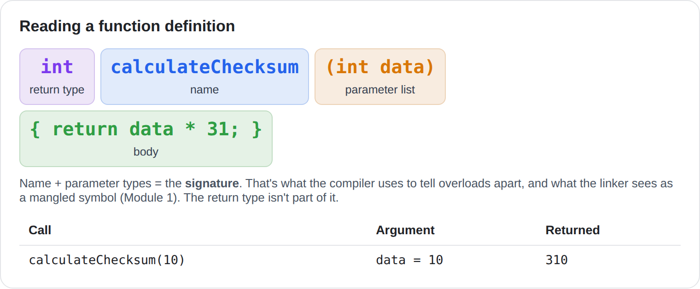

The name plus the parameter types is the function's signature. The return type isn't part of it, which matters in section 4.

A call copies the arguments into the parameters, runs the body in a fresh stack frame, and hands the return value back. A `void` function, like `deleteFile(const std::string&)`, just doesn't hand anything back.

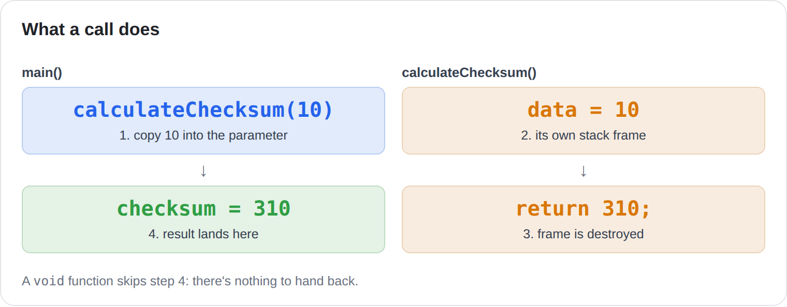

## 2. Choosing the parameter type

Module 5 covered the mechanics: `int size` gets a copy, `int& size` gets the original, `const int& size` gets the original read-only. In practice the choice comes down to four cases:

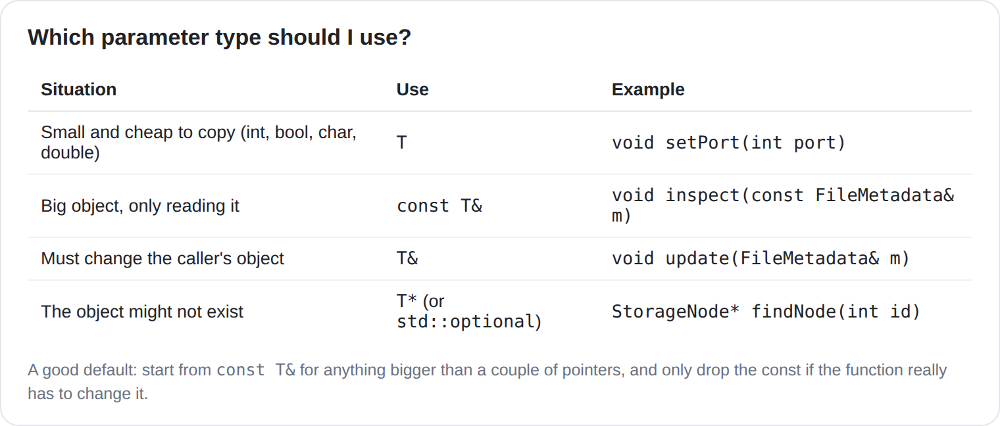

```cpp
void inspect(const FileMetadata& metadata);   // reads, no copy
void update(FileMetadata& metadata);          // changes the caller's object
```

Reading the signature tells you what the function can do to your object without reading its body. A `const&` parameter can't change it, a plain `&` probably will.

## 3. Default arguments

```cpp
void readFile(const std::string& filename, int bufferSize = 4096);

readFile("data.bin");
readFile("data.bin", 8192);
```

```
reading data.bin with a 4096-byte buffer
reading data.bin with a 8192-byte buffer
```

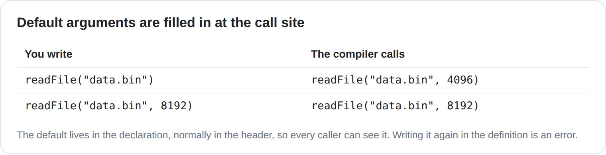

The compiler fills in the default at the call site, so it has to see the default when compiling the call. That's why the default goes in the declaration (normally the header) and not in the definition. Writing it in both places is an error.

## 4. Overloading

C++ lets two functions share a name as long as their parameter types differ:

```cpp
int calculateChecksum(int data);
int calculateChecksum(const std::string& data);
```

```
calculateChecksum(10)    = 310
calculateChecksum("EOS") = 68841
```

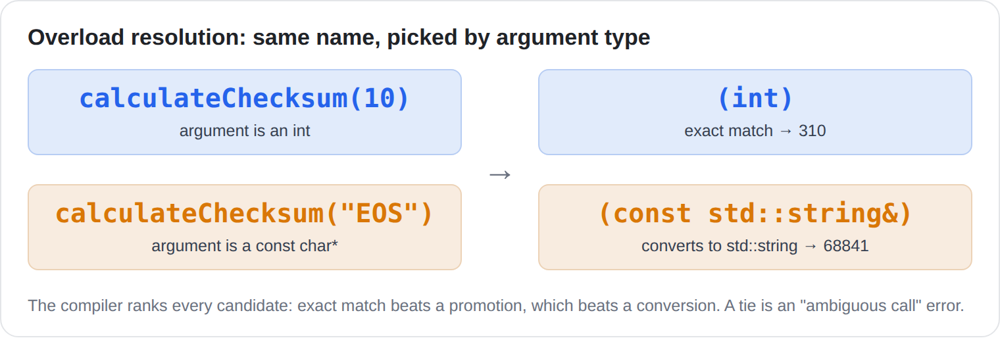

The compiler looks at the argument types and ranks every candidate. `10` is an exact match for `int`. `"EOS"` is a `const char*`, which isn't an exact match for anything, but it converts to `std::string`, so that overload wins. If two candidates rank equally, the call is ambiguous and won't compile.

This only works because of name mangling from Module 1. Each overload becomes a different symbol, with the parameter types encoded in it:

```
$ nm overloading.o | grep calculateChecksum
0000000000000017 T _Z17calculateChecksumRKNSt7__cxx1112basic_stringIcSt11char_traitsIcESaIcEEE
0000000000000000 T _Z17calculateChecksumi
```

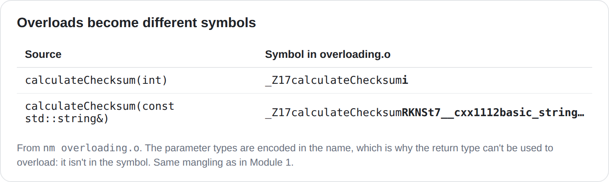

The `i` at the end of the first symbol is the `int`. `RK...basic_string...` is "reference to const `std::string`". The return type isn't in there anywhere, so two functions that differ only in return type would get the same symbol:

```cpp
int getSize()    { return 100; }
double getSize() { return 100.0; }
```

```
error: ambiguating new declaration of 'double getSize()'
```

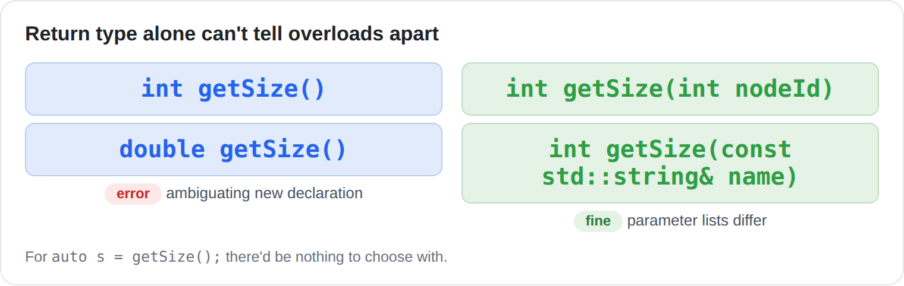

There's also nothing to choose with at the call site: in `auto s = getSize();`, nothing says which one you wanted.

## 5. `inline`

```cpp
inline int square(int x) { return x * x; }
```

The name suggests "paste this function's body into every call". That's not what it means today. Compilers decide what to inline on their own when optimising, with or without the keyword.

What `inline` actually does is relax the One Definition Rule from Module 1. A normal function defined in a header and included in two `.cpp` files gives a "multiple definition" linker error. Marked `inline`, it's allowed to be defined in every translation unit, as long as every definition is identical. Functions defined inside a class body are implicitly `inline`, which is why header-only classes link fine.

## 6. Lambdas

Sometimes a function is only needed in one place, often as an argument to another function. Writing it out separately and naming it is more ceremony than it's worth. A lambda is a function written inline:

```cpp
auto isHealthy = [](int nodeId) { return nodeId > 2; };
isHealthy(3);   // true
```

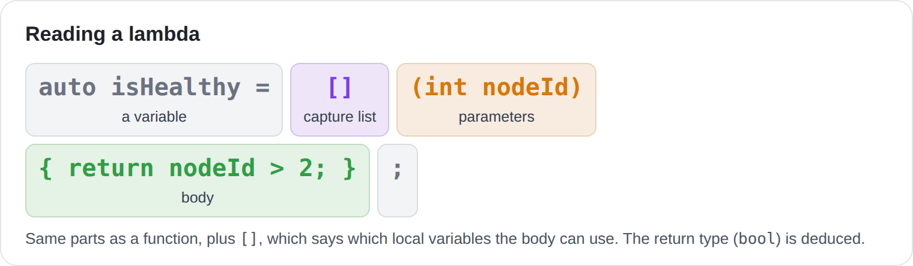

### A lambda is an object

This is the key idea. The compiler turns each lambda into a small class with an `operator()`, and the lambda expression creates an object of that class. Any variables it captures become data members:

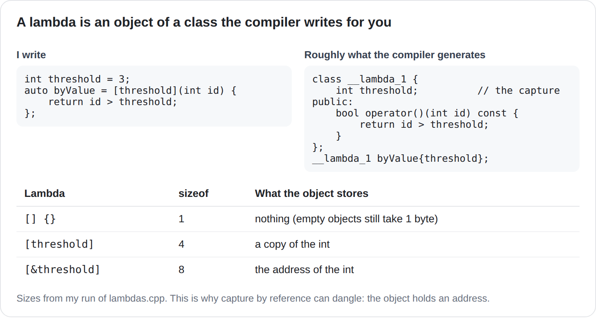

```
sizeof: [] 1, [threshold] 4, [&threshold] 8
```

A lambda that captures nothing is an empty object (1 byte, because every object needs an address). Capturing an `int` by value stores the int. Capturing it by reference stores its address, 8 bytes, like a pointer.

### Capture by value vs by reference

The capture list decides which local variables the body can use, and how:

```cpp
int threshold = 3;
auto byValue = [threshold](int nodeId) { return nodeId > threshold; };
auto byRef   = [&threshold](int nodeId) { return nodeId > threshold; };
threshold = 10;
```

```
threshold changed to 10. Is node 5 healthy?
  [threshold]  says true
  [&threshold] says false
```

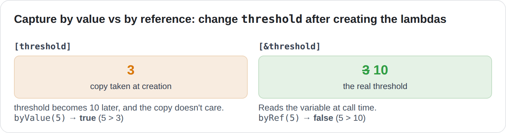

`byValue` copied 3 when it was created and doesn't care what happens to `threshold` afterwards. `byRef` reads the real variable every time it runs.

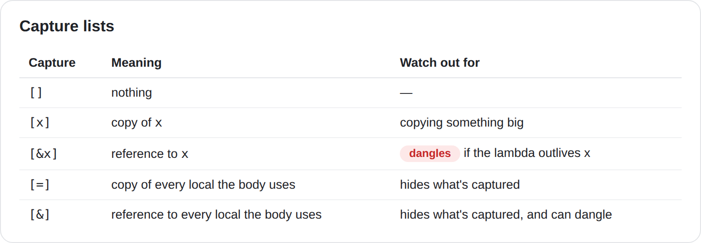

### Lambdas with algorithms

This is where lambdas are used most. `std::sort` sorts ascending by default. To sort nodes with the most free space first, I pass a lambda that answers "should `a` come before `b`?":

```cpp
std::sort(freeGb.begin(), freeGb.end(), [](int a, int b) { return a > b; });
```

```
before sort: 500 200 800 100 400
most free first: 800 500 400 200 100
```

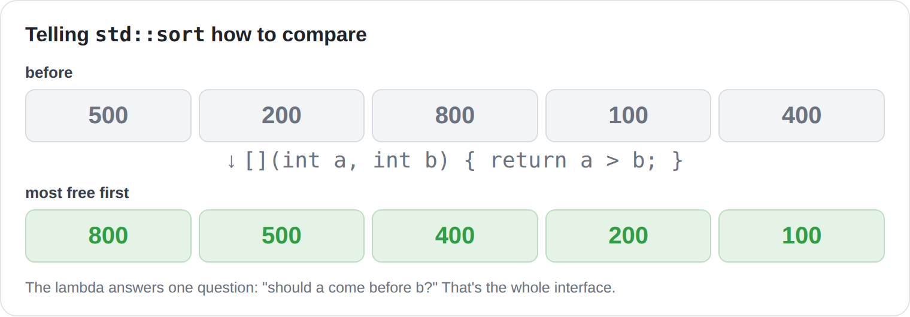

A capture lets the lambda use a local setting without a global variable:

```cpp
int minFree = 300;
auto usable = std::count_if(freeGb.begin(), freeGb.end(),
                            [minFree](int gb) { return gb >= minFree; });
```

```
3 nodes have at least 300 GB free
```

The same pattern shows up in callbacks, thread pools and async I/O in later phases: a lambda packages up some work plus the data it needs, to be run later, somewhere else.

### When a lambda outlives what it captured

"Later, somewhere else" is exactly where capture by reference goes wrong:

```cpp
std::function<bool(int)> makeChecker() {
    int threshold = 3;
    return [&threshold](int nodeId) { return nodeId > threshold; };
}

auto isHealthy = makeChecker();
isHealthy(5);
```

The lambda stores the address of `threshold`, but `threshold` lives in `makeChecker`'s stack frame, which is gone by the time `isHealthy(5)` runs. It's the dangling pointer from Module 4 again, hidden inside a lambda. And this time GCC gives no warning:

```
isHealthy(5) = false
```

5 > 3 should be `true`. The plain build quietly read whatever was left in that stack slot. AddressSanitizer catches it (the example turns on ASan's stack-lifetime checking, which is off by default):

```
ERROR: AddressSanitizer: stack-use-after-return on address 0x72ec508000b0
READ of size 4 at 0x72ec508000b0 thread T0
    #0 in operator() dangling_lambda.cpp:11
    #5 in main dangling_lambda.cpp:16
  This frame has 2 object(s):
    [48, 52) 'threshold' (line 10) <== Memory access at offset 48 is inside this variable
```

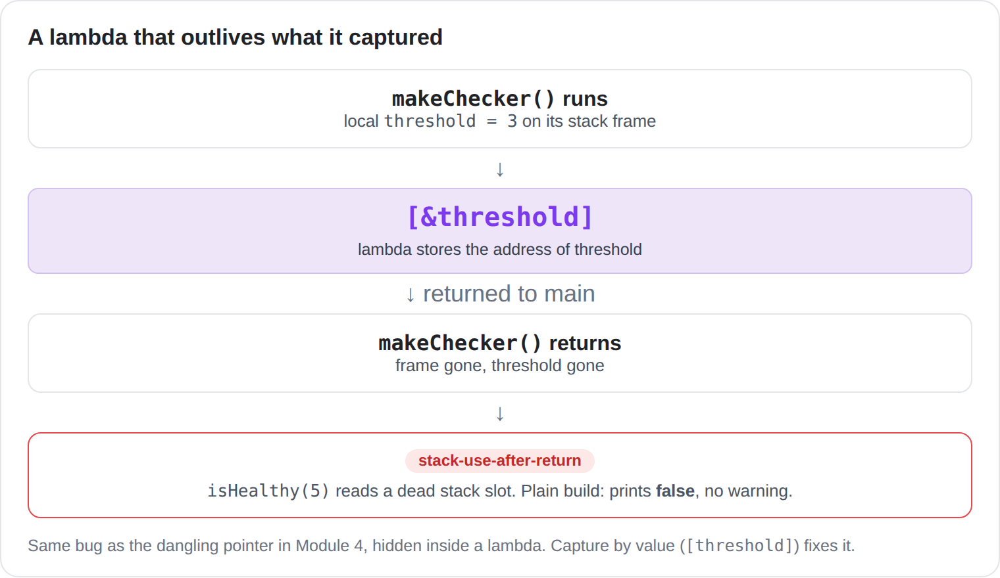

The fix is `[threshold]`: capture by value, so the lambda carries its own copy. A safe default: if a lambda is stored, returned, or handed to another thread, capture by value unless there's a clear reason not to.

---

Next: [Module 7, classes, encapsulation and access control](../07-classes-encapsulation-access-control/).
