# Module 7: Classes, encapsulation and access control

So far the storage-node examples have been loose variables and small structs. A class groups the data and the functions that work on it into one type, and, more importantly, lets that type decide who can change its data. This module is about why that second part matters: a class is only worth having if it keeps its objects in a valid state.

All the code is in [`examples/`](examples/). `./run.sh` runs every example, then rebuilds two of them with `-DSHOW_ERRORS` to show the access errors. The output is from GCC 11 on x86-64 Linux. Your addresses will be different.

| File | What it shows | Run it |
|---|---|---|
| [`class_basics.cpp`](examples/class_basics.cpp) | Objects, member functions, `sizeof` and `this` | [Compiler Explorer](https://godbolt.org/z/nE9MG7zv6) |
| [`encapsulation.cpp`](examples/encapsulation.cpp) | Public data vs private data behind a checked setter | [Compiler Explorer](https://godbolt.org/z/eP8qEz6cj) |
| [`storage_node.cpp`](examples/storage_node.cpp) | Constructor, initialiser list, `const` member functions | [Compiler Explorer](https://godbolt.org/z/YehndKr44) |
| [`init_order.cpp`](examples/init_order.cpp) | Members initialised in the wrong order (broken on purpose) | [Compiler Explorer](https://godbolt.org/z/GT8sxcG19) |

---

## 1. Why classes

A storage node has an ID, a total capacity, used capacity and a health flag. As loose variables:

```cpp
int nodeId = 1;
int totalCapacity = 1000;
int usedCapacity = 400;
bool healthy = true;

void printNodeInfo();
void updateCapacity();
void markNodeUnhealthy();
```

Nothing connects these. A second node means four more variables, and every function needs to be told which set to use.

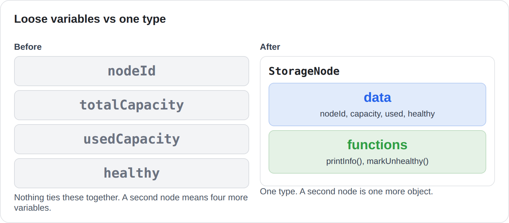

## 2. Classes and objects

```cpp
class StorageNode {
public:
    int nodeId;
    int totalCapacity;
    int usedCapacity;

    void printInfo() {
        std::cout << "node " << nodeId << ": " << usedCapacity << "/" << totalCapacity << " used\n";
    }
};

StorageNode node1{1, 1000, 400};
StorageNode node2{2, 2000, 1500};
```

The class is the type. Each object of that type has its own copy of the data members.

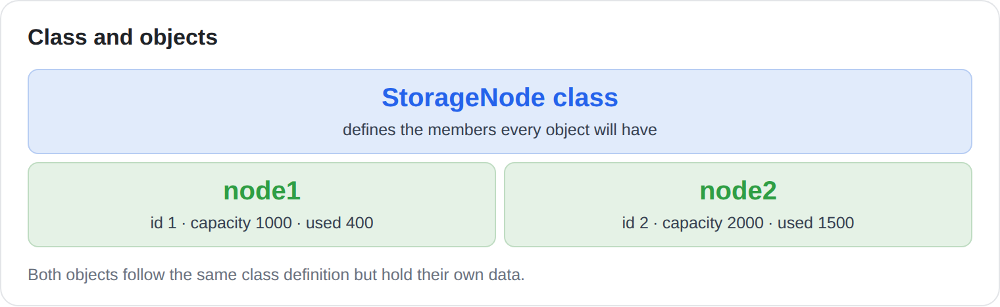

### What's inside an object

```
&node1 = 0x7fffc39da870, &node2 = 0x7fffc39da87c
sizeof(StorageNode) = 12
```

12 bytes is three `int`s, and nothing else. `node2` sits 12 bytes (`0x...870` to `0x...87c`) after `node1`. The member function isn't stored in the object. `printInfo()` is compiled once, like any other function, and every object shares that one copy of the machine code.

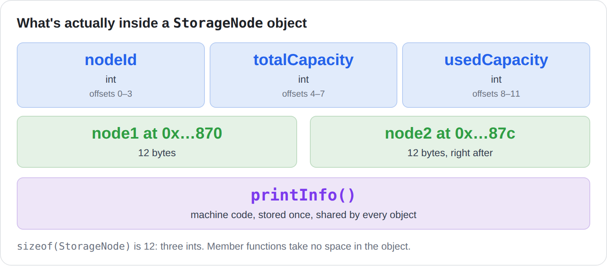

### `this`

So how does the one shared `printInfo()` know which object's `usedCapacity` to print? The compiler passes it a hidden pointer to the object, called `this`:

```
node 1: 400/1000 used (this = 0x7fffc39da870)
node 2: 1500/2000 used (this = 0x7fffc39da87c)
```

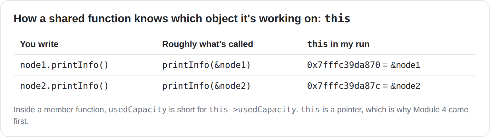

`this` is `&node1` in the first call and `&node2` in the second. Inside a member function, `usedCapacity` is short for `this->usedCapacity`. A member function is basically a normal function with an extra pointer parameter, which is why pointers came first.

## 3. Encapsulation

With everything public, nothing stops this:

```cpp
OpenNode open{1000, 400};
open.usedCapacity = 2000;
```

```
open node available: -1000
```

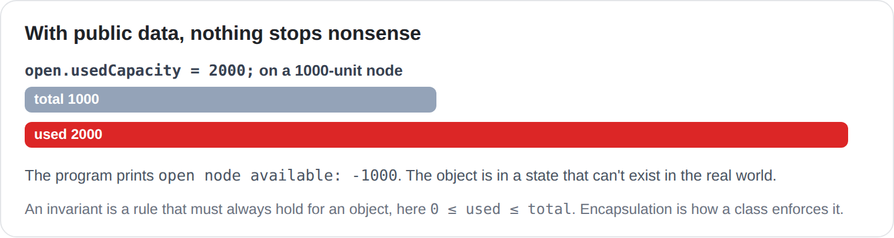

A node using 2000 units out of 1000 can't exist. Every node should satisfy `0 <= used <= total`. A rule like that, which must always hold for an object, is called an invariant. With public data, every piece of code that touches a node has to remember the rule. With private data, only the class has to:

```cpp
class StorageNode {
    int totalCapacity = 0;
    int usedCapacity = 0;

public:
    bool setCapacity(int total, int used) {
        if (used < 0 || used > total) {
            return false;
        }
        totalCapacity = total;
        usedCapacity = used;
        return true;
    }

    int getAvailableCapacity() const { return totalCapacity - usedCapacity; }
};
```

```
setCapacity(1000, 400):  true
setCapacity(1000, 2000): false
available: 600
```

And going around the setter doesn't compile:

```
error: 'int StorageNode::usedCapacity' is private within this context
```

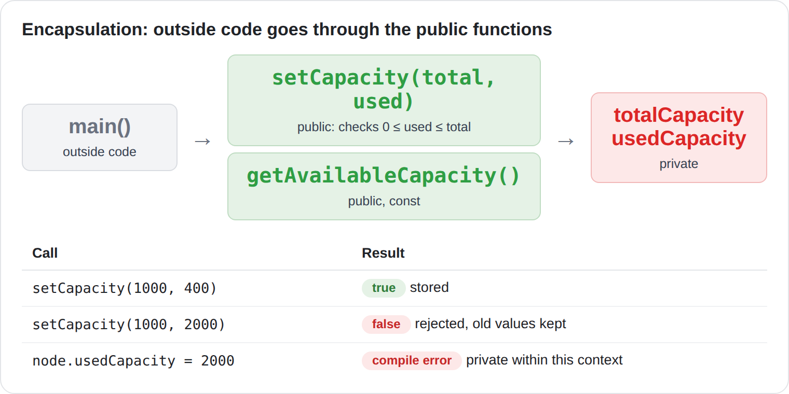

That's encapsulation: the data is private, and the public functions are the only way in, so they can enforce the invariant. It also means the class can change how it stores things later (say, `freeCapacity` instead of `usedCapacity`) without breaking any code outside it.

## 4. `public`, `protected`, `private`

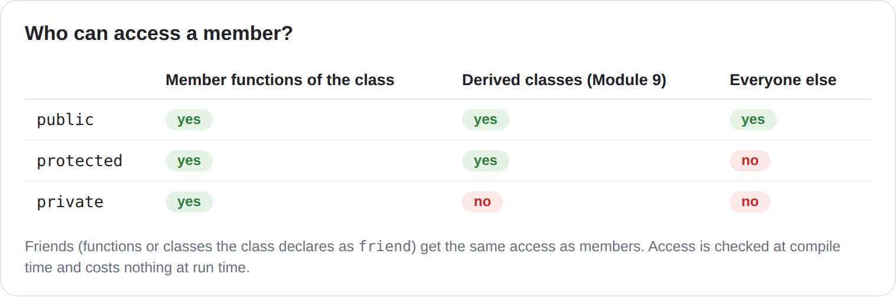

`protected` only matters with inheritance, which is Module 9. Access is checked entirely at compile time. A private member costs nothing at run time. It's the same bytes in the same place, and the compiler just refuses to let outside code name it.

### `class` vs `struct`

```cpp
class A  { int x; };   // x is private
struct B { int x; };   // x is public
```

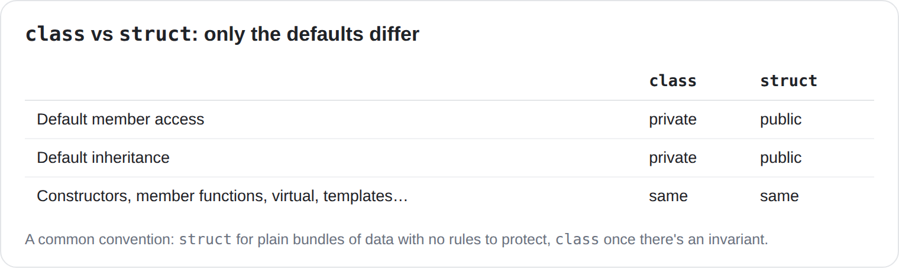

That's the only difference. A `struct` can have constructors, private members and virtual functions, and a `class` can be all public. The convention I'm following in this repo: `struct` for plain data with no invariant to protect (like `FileMetadata` in Module 5), `class` once there is one.

## 5. Constructors

The `StorageNode` from section 2 has a problem: `StorageNode n;` with no initialiser leaves its `int` members indeterminate. Reading them is undefined behaviour. A constructor runs as the object is created, so there's never a moment when it exists but isn't set up:

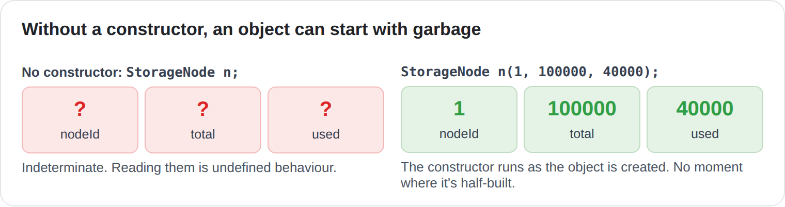

```cpp
class StorageNode {
public:
    StorageNode(int id, std::string host, std::uint64_t total, std::uint64_t used)
        : nodeId(id), hostname(std::move(host)), totalCapacity(total), usedCapacity(used) {
        if (used > total) {
            throw std::invalid_argument("used capacity exceeds total");
        }
    }
    // ...
private:
    int nodeId;
    std::string hostname;
    std::uint64_t totalCapacity;
    std::uint64_t usedCapacity;
    bool healthy = true;
};
```

The part after the `:` is the member initialiser list. It constructs each member directly with its value. Assigning in the constructor body instead (`hostname = host;`) would default-construct the string first and then assign over it. For `const` members, reference members, or members with no default constructor, the body version doesn't even compile.

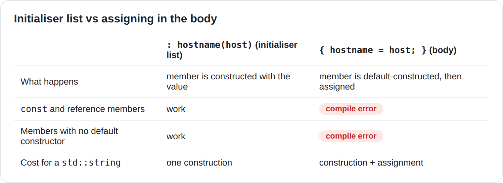

`healthy = true` next to the member declaration is a default member initialiser, used by any constructor that doesn't set it. `std::move(host)` hands the string's memory over instead of copying it (Phase 2).

The constructor also checks the invariant. A constructor can't return `false`, so the only way to refuse to create an invalid object is to throw. Exceptions are Module 10. For now, this is enough:

```
rejected fst-03: used capacity exceeds total
```

### Members are initialised in declaration order

This one is easy to get wrong. The order of the initialiser list doesn't matter. Members are always initialised in the order they're declared in the class:

```cpp
class Volume {
public:
    Volume(int total, int used)
        : totalCapacity(total), usedCapacity(used),
          availableCapacity(totalCapacity - usedCapacity) {}
private:
    int availableCapacity;   // declared first, so initialised first
    int totalCapacity;
    int usedCapacity;
};
```

```
warning: 'Volume::usedCapacity' will be initialized after [-Wreorder]
warning: '*this.Volume::totalCapacity' is used uninitialized [-Wuninitialized]
total=1000 used=400 available=1690441452
```

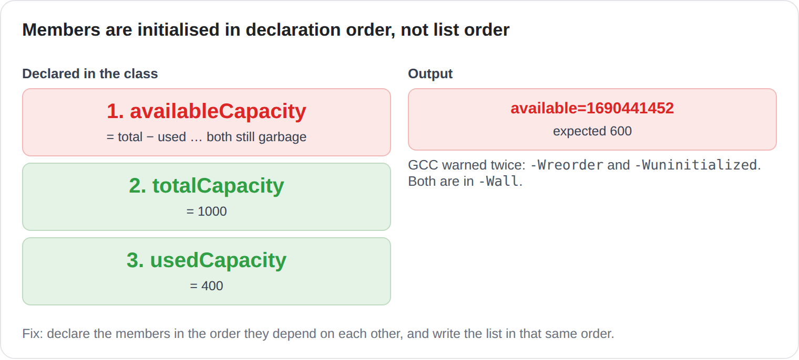

`availableCapacity` is computed before `totalCapacity` and `usedCapacity` have values. Both warnings are in `-Wall`, which is one more reason to always build with it.

## 6. `const` member functions

From Module 3: a `const` after the parameter list means the function promises not to change the object.

```cpp
std::uint64_t getAvailableCapacity() const { return totalCapacity - usedCapacity; }
void markUnhealthy() { healthy = false; }
```

```cpp
const StorageNode backup(2, "fst-02", 50000, 10000);
backup.getAvailableCapacity();   // 40000
backup.markUnhealthy();          // error
```

```
error: passing 'const StorageNode' as 'this' argument discards qualifiers [-fpermissive]
```

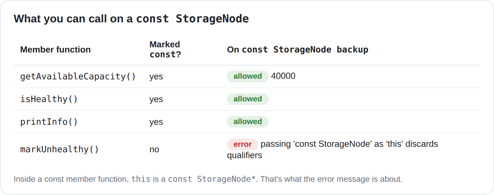

The error makes sense with section 2 in mind. Inside a `const` member function, `this` is a `const StorageNode*`. Calling `markUnhealthy()` on a const object would mean passing a `const StorageNode*` where a plain `StorageNode*` is expected, which drops ("discards") the `const`. This also connects back to Module 5: any function that takes `const StorageNode&` can only call `const` member functions. So every member function that doesn't change the object should be marked `const`, or it can't be used through a `const&`.

## 7. How Modules 5–7 fit together

Here's a sketch (not one of the examples) that uses all three:

```cpp
void reserve(StorageNode& node, std::uint64_t bytes);        // Module 5: works on the caller's node
auto canWrite = [minFree](const StorageNode& n) {            // Module 6: a lambda as a check
    return n.isHealthy() && n.getAvailableCapacity() >= minFree;
};
node.markUnhealthy();                                         // Module 7: state changes go through the class
```

References decide who owns and who borrows an object, functions and lambdas decide what can be done to it, and classes decide which changes are allowed at all. Module 8 picks up where constructors left off: copying objects, destructors, and when exactly an object's lifetime starts and ends.

---

Next: [Module 8, constructors, destructors and object lifetimes](../08-constructors-destructors-lifetimes/).
