# Module 8: Constructors, destructors and object lifetimes

Module 7 used a constructor to make sure a `StorageNode` could never start out invalid. This module covers the other end too: what happens when an object is destroyed, in what order, and what decides when. For local objects the answer is the code itself, down to the closing brace, and that's what lets C++ tie resources like files to an object's lifetime.

All the code is in [`examples/`](examples/). `./run.sh` runs every example, runs the leak example under AddressSanitizer, then rebuilds two examples with `-DSHOW_ERRORS` to show the compiler errors. The output is from GCC 11 on x86-64 Linux.

| File | What it shows | Run it |
|---|---|---|
| [`lifecycle.cpp`](examples/lifecycle.cpp) | When constructors and destructors run, and in what order | [Compiler Explorer](https://godbolt.org/z/c85vs1e89) |
| [`default_constructor.cpp`](examples/default_constructor.cpp) | When `StorageNode n;` compiles, and `= default` | [Compiler Explorer](https://godbolt.org/z/Ex679x5jv) |
| [`members.cpp`](examples/members.cpp) | Members are built before the constructor body and destroyed after the destructor body | [Compiler Explorer](https://godbolt.org/z/f3nWYPTKb) |
| [`dynamic_lifetime.cpp`](examples/dynamic_lifetime.cpp) | `new` and `delete`, and a leak (broken on purpose) | [Compiler Explorer](https://godbolt.org/z/vPTbjK3bd) |
| [`storage_file.cpp`](examples/storage_file.cpp) | A class that closes its file in the destructor (RAII) | [Compiler Explorer](https://godbolt.org/z/4ozxhGE1x) |

---

## 1. The problem

A storage node needs an ID, a hostname, a capacity, and probably an open file or socket. Two questions come with that: how does the object get its starting values, and who closes the file when the node isn't needed any more? Constructors answer the first one, destructors answer the second, and object lifetime is the rule for when each one runs.

## 2. Constructors

```cpp
class StorageNode {
public:
    StorageNode(int id) : nodeId(id) {}
    int nodeId;
};

StorageNode node1(10);
StorageNode node2(20);
```

A constructor has the same name as the class and no return type, not even `void`. It runs as the object is created, so `node1.nodeId` is 10 from the very first moment `node1` exists. The `: nodeId(id)` part is the member initialiser list from Module 7: it builds the member with its value directly instead of creating it first and assigning afterwards.

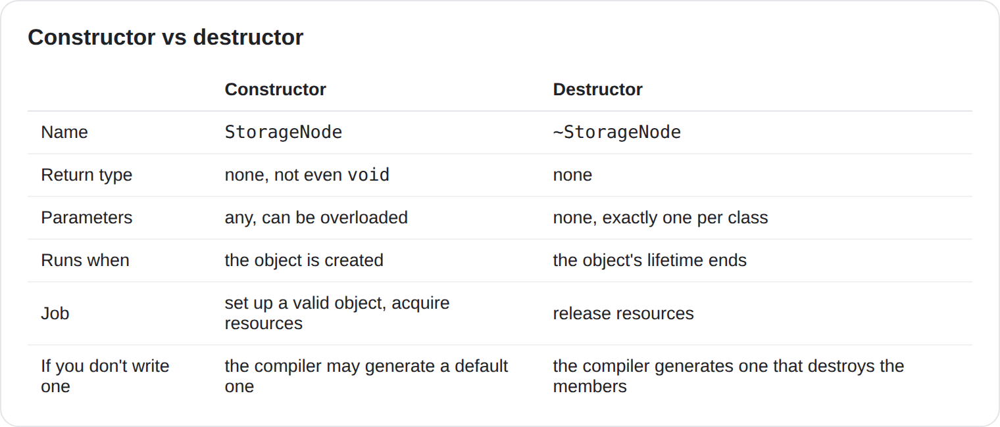

### Default constructors

A default constructor is one that can be called with no arguments. Here's the part that's easy to trip over: if a class declares any constructor at all, the compiler stops generating the no-argument one.

```cpp
class Configured {
public:
    Configured(int id) : nodeId(id) {}
    int nodeId;
};

Configured d;   // error: no matching function for call to 'Configured::Configured()'
```

`= default` asks for it back. Combined with a default member value, the defaulted constructor produces a sensible object instead of garbage:

```cpp
class Defaulted {
public:
    Defaulted() = default;
    Defaulted(int id) : nodeId(id) {}
    int nodeId = 0;
};
```

```
a.nodeId = 10
b.nodeId = 0
c.nodeId = 20
```

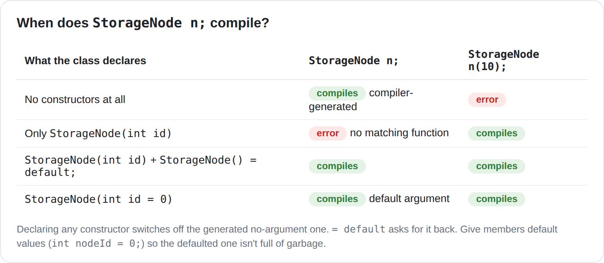

## 3. Destructors

```cpp
class StorageNode {
public:
    explicit StorageNode(std::string name) : name(std::move(name)) {
        std::cout << "  constructor: " << this->name << '\n';
    }
    ~StorageNode() {
        std::cout << "  destructor:  " << name << '\n';
    }
private:
    std::string name;
};
```

The destructor is the class name with a `~` in front. No return type, no parameters, and only one per class. It runs when the object's lifetime ends. For a local object, that's the closing brace of the block it was declared in:

```cpp
{
    std::cout << "  before object\n";
    StorageNode node("fst-01");
    std::cout << "  after object, doing work\n";
}
```

```
  before object
  constructor: fst-01
  after object, doing work
  destructor:  fst-01
```

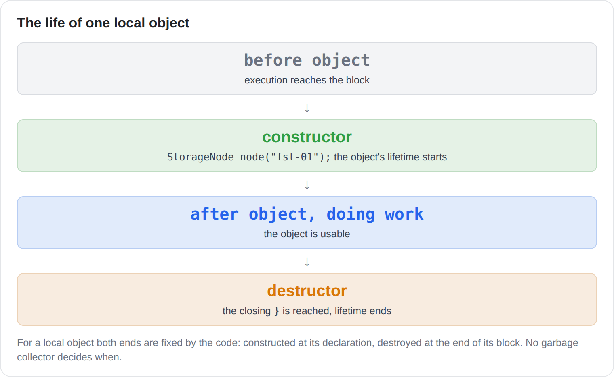

There's no garbage collector deciding when to clean up. Looking at the code, I can point at the exact line where the destructor runs. That's what "deterministic destruction" means, and the rest of this module and most of Phase 2 builds on it.

(`explicit` stops the compiler from silently converting a `std::string` into a `StorageNode`. It's a good default for one-argument constructors.)

## 4. Destruction order

Three objects in one block:

```cpp
{
    StorageNode node1("node1");
    StorageNode node2("node2");
    StorageNode node3("node3");
}
```

```
  constructor: node1
  constructor: node2
  constructor: node3
  destructor:  node3
  destructor:  node2
  destructor:  node1
```

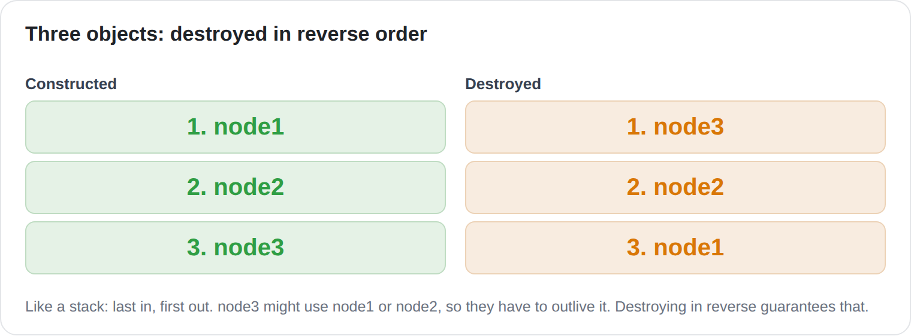

Reverse order, like a stack. `node3` was created when `node1` and `node2` already existed, so it might depend on them. Destroying it first means nothing is ever destroyed while something created later might still use it.

Nested blocks follow the same rule, each `}` ending only the objects declared inside it:

```
  constructor: outer
  constructor: inner
  leaving inner block
  destructor:  inner
  back in main
end of main
  destructor:  outer
```

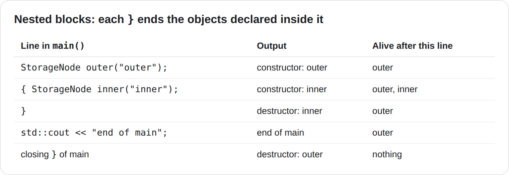

### Members

The same ordering applies inside an object. A `StorageNode` with a `Disk` member and a `NetworkLink` member:

```cpp
class StorageNode {
public:
    StorageNode()  { std::cout << "  StorageNode constructor body\n"; }
    ~StorageNode() { std::cout << "  StorageNode destructor body\n"; }
private:
    Disk disk;
    NetworkLink link;
};
```

```
creating node
  Disk constructed
  NetworkLink constructed
  StorageNode constructor body
using node
  StorageNode destructor body
  NetworkLink destroyed
  Disk destroyed
node is gone
```

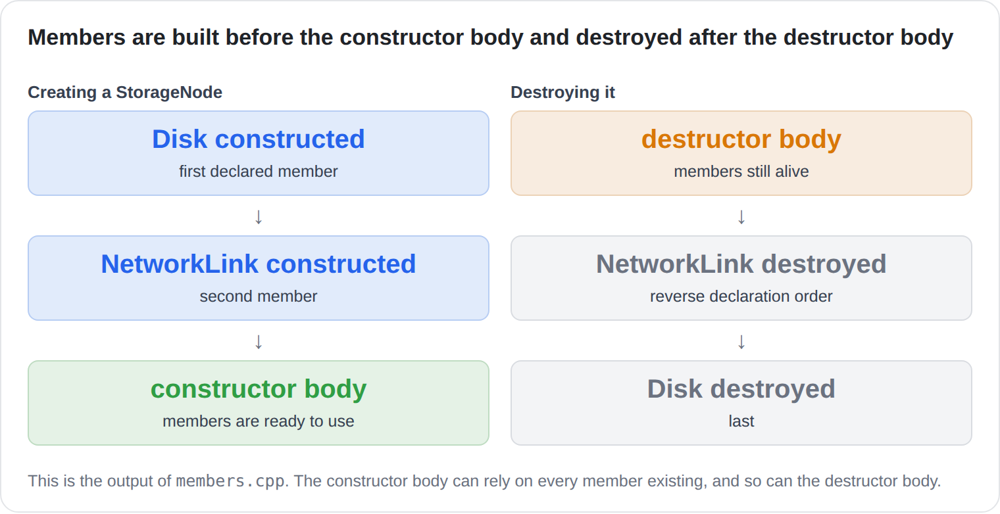

Members are built in declaration order (the rule from Module 7's initialisation-order bug) before the constructor body runs, and destroyed in reverse after the destructor body finishes. So the constructor body can use every member, and so can the destructor body.

## 5. Lifetime vs scope

For local objects, lifetime and scope line up. With `new` they don't:

```cpp
void withDelete() {
    StorageNode* node = new StorageNode(1);
    delete node;
}

void withoutDelete() {
    StorageNode* node = new StorageNode(2);
}
```

```
withDelete()
  constructor: node 1
  destructor:  node 1
withoutDelete()
  constructor: node 2
end of main
```

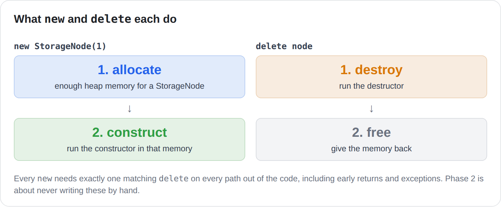

Node 2's destructor never runs. `node` is a local pointer, so the pointer is destroyed at the end of `withoutDelete()`. The `StorageNode` it pointed at lives on the heap, and heap objects live until someone calls `delete`. Nobody does, and now nothing points to it either. AddressSanitizer reports it when the program exits:

```
==35827==ERROR: LeakSanitizer: detected memory leaks
Direct leak of 4 byte(s) in 1 object(s) allocated from:
    #0 in operator new(unsigned long)
    #1 in withoutDelete() dynamic_lifetime.cpp:18
```

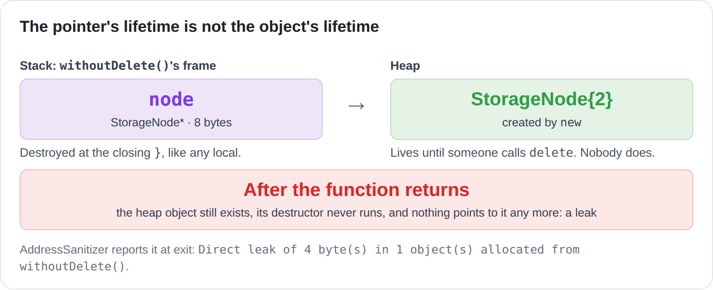

The pointer's lifetime is not the object's lifetime. That sentence is most of Phase 2.

One detail from running this: the leak check only fired with `-O1`. At `-O0`, a stale copy of the pointer was still sitting in memory, and the leak checker treats anything that looks like a pointer as a reference to the object, so it didn't report anything. The `run.sh` builds with `-O1` for that reason.

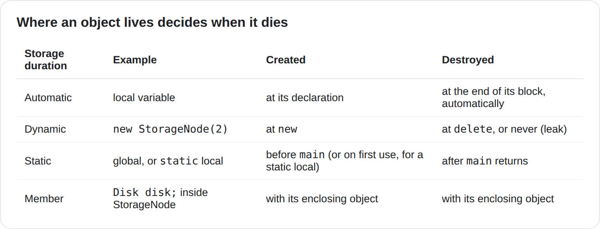

## 6. Destructors that clean up: RAII

If a destructor always runs at a known point, it's the natural place to release a resource. Here's a class that owns an open file:

```cpp
class StorageFile {
public:
    explicit StorageFile(const char* path) : file(std::fopen(path, "rb")) {
        if (file == nullptr) {
            throw std::runtime_error(std::string("can't open ") + path);
        }
        std::cout << "  opened " << path << '\n';
    }

    ~StorageFile() {
        std::fclose(file);
        std::cout << "  closed\n";
    }

    StorageFile(const StorageFile&) = delete;
    StorageFile& operator=(const StorageFile&) = delete;

    long size() const;

private:
    std::FILE* file;
};
```

```cpp
{
    StorageFile f("node.dat");
    std::cout << "  size: " << f.size() << " bytes\n";
}
```

```
  opened node.dat
  size: 21 bytes
  closed
after the block
  error: can't open missing.dat
```

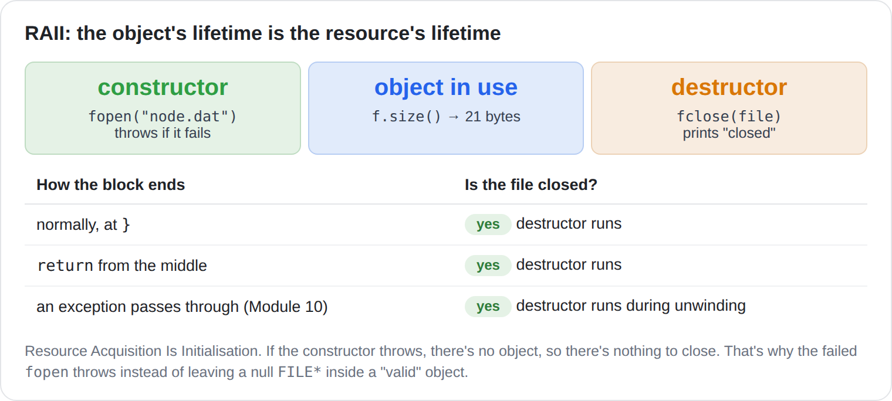

There's no `fclose` in the calling code. The file is closed because the object's lifetime ended. This is RAII, Resource Acquisition Is Initialisation: get the resource in the constructor, release it in the destructor. It works however the block ends: normally, through an early `return`, or because an exception passes through (Module 10 shows that happening).

The source version of this class had two gaps, and fixing them is where the real design is:

- If `fopen` fails, the constructor throws. An object that exists always holds an open file, so the destructor never has to check for null, and the caller can't forget to check either.
- Copying is deleted. A copied `StorageFile` would hold the same `FILE*`, and both destructors would close it. With `= delete`, the mistake doesn't compile:

```
error: use of deleted function 'StorageFile::StorageFile(const StorageFile&)'
```

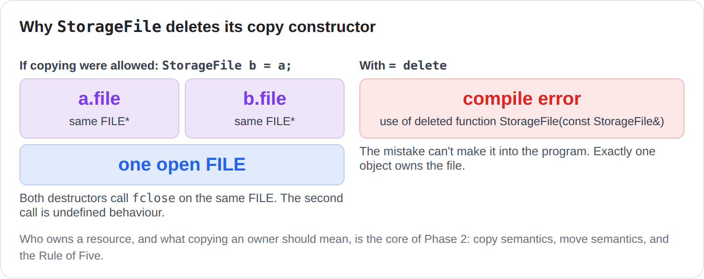

What it should mean to copy or move an object that owns something is Phase 2: copy semantics, move semantics, and the Rule of Five.

---

Next: [Module 9, inheritance, virtual functions and polymorphism](../09-inheritance-virtual-polymorphism/).
