# Module 9: Inheritance, virtual functions and polymorphism

A storage system has more than one kind of node: SSDs, hard drives, NVMe drives. They share most of their data and behaviour but each does I/O its own way. This module is about writing code once against "a storage node" and having the right version run for whatever node is actually there, and about what the compiler builds to make that happen.

All the code is in [`examples/`](examples/). `./run.sh` runs every example, lists the vtables with `nm`, runs the broken destructor example under AddressSanitizer, then rebuilds two examples with `-DSHOW_ERRORS` to show the compiler errors. The output is from GCC 11 on x86-64 Linux.

| File | What it shows | Run it |
|---|---|---|
| [`inheritance.cpp`](examples/inheritance.cpp) | Base and derived classes, `protected`, object layout | [Compiler Explorer](https://godbolt.org/z/5E88qdc7Y) |
| [`virtual_dispatch.cpp`](examples/virtual_dispatch.cpp) | `virtual` vs non-virtual calls, slicing, the size cost of a vptr | [Compiler Explorer](https://godbolt.org/z/xY635o3P9) |
| [`abstract.cpp`](examples/abstract.cpp) | Pure virtual functions, abstract classes, `override` | [Compiler Explorer](https://godbolt.org/z/da35v97h7) |
| [`virtual_destructor.cpp`](examples/virtual_destructor.cpp) | Deleting through a base pointer without a virtual destructor (broken on purpose) | [Compiler Explorer](https://godbolt.org/z/K8KzxoxGG) |

---

## 1. Inheritance

```cpp
class StorageNode {
public:
    int nodeId = 0;
    void printInfo() const;
protected:
    int capacity = 0;
private:
    int internalSecret = 42;
};

class SSDNode : public StorageNode {
public:
    SSDNode(int id, int gb) { nodeId = id; capacity = gb; }
    void optimiseForRandomIO() const;
private:
    int eraseCycles = 0;
};
```

`class SSDNode : public StorageNode` means an SSDNode is a StorageNode with extra parts. It gets `nodeId`, `capacity` and `printInfo()` without writing them again:

```
node 1, 1000 GB
SSD 1: optimising for random I/O
node 2, 8000 GB
HDD 2: optimising for sequential I/O
```

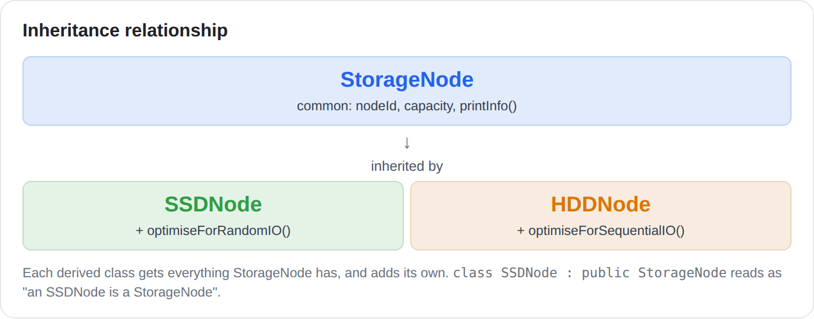

### What's inside an SSDNode

```
sizeof(StorageNode) = 12
sizeof(SSDNode)     = 16
&ssd = 0x7ffdae4a3bb0, base = 0x7ffdae4a3bb0
```

An SSDNode is 16 bytes: a whole 12-byte StorageNode, then its own `eraseCycles`. A `StorageNode*` pointing at it holds the same address, because the StorageNode part sits at the start. That's why converting an `SSDNode*` to a `StorageNode*` is free.

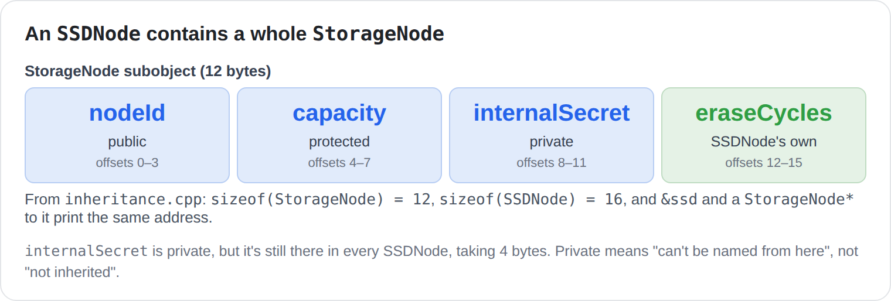

`internalSecret` is in there too, taking 4 bytes. Private members are inherited. They just can't be named by the derived class.

### protected

`protected` from Module 7 finally has a use: derived classes can touch it, outside code can't.

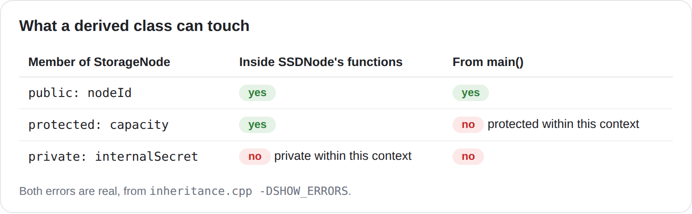

Both errors from `-DSHOW_ERRORS`:

```
inheritance.cpp:30:32: error: 'int StorageNode::internalSecret' is private within this context
inheritance.cpp:50:9: error: 'int StorageNode::capacity' is protected within this context
```

The `public` in `: public StorageNode` is a separate thing. It caps how visible the inherited members are from outside:

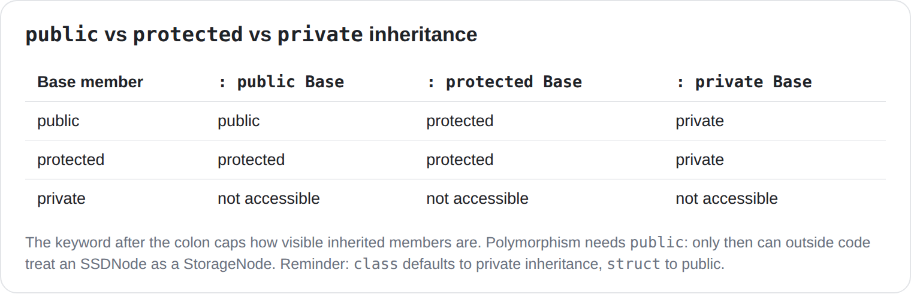

Almost every real hierarchy uses `public`, because that's the only mode where outside code can treat an SSDNode as a StorageNode.

## 2. Runtime polymorphism

I want a list of nodes and one loop that does I/O on each, without the loop knowing which kinds exist:

```cpp
class StorageNode {
public:
    virtual void performIO() const { std::cout << "generic storage I/O\n"; }
    virtual ~StorageNode() = default;
};

class SSDNode : public StorageNode {
public:
    void performIO() const override { std::cout << "SSD random I/O\n"; }
};

class HDDNode : public StorageNode {
public:
    void performIO() const override { std::cout << "HDD sequential I/O\n"; }
};

const StorageNode* nodes[] = {&ssd, &hdd};
for (const StorageNode* node : nodes) {
    node->performIO();
}
```

```
SSD random I/O
HDD sequential I/O
```

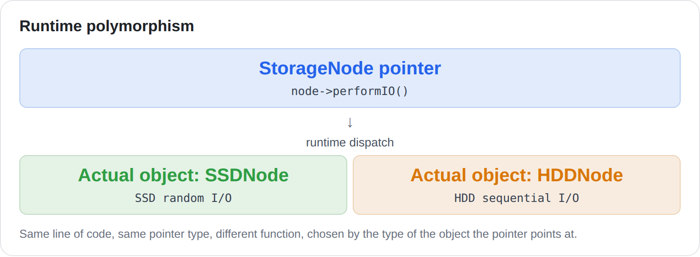

The same line runs two different functions. `virtual` tells the compiler to pick the function from the type of the object at run time, its dynamic type, instead of the type of the pointer.

(`node->performIO()` is just `(*node).performIO()`: follow the pointer, then call the member.)

### Without virtual

`describe()` isn't virtual, and SSDNode has its own:

```cpp
const StorageNode* base = &ssd;
base->describe();
ssd.describe();
```

```
plain StorageNode::describe
SSDNode::describe
```

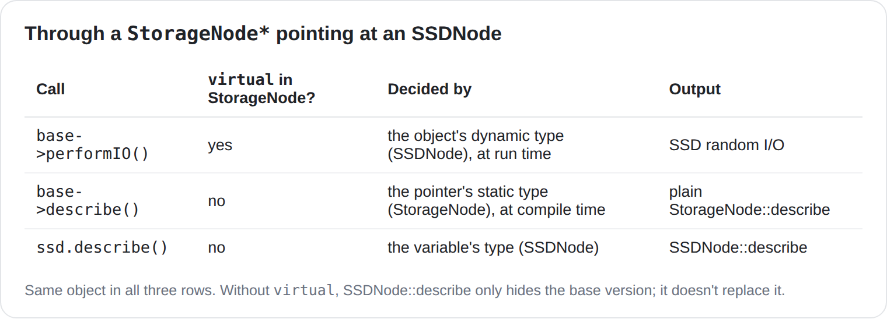

Same object both times. Without `virtual`, the compiler picks the function from the pointer's type when compiling, and `SSDNode::describe` only hides the base version for code that calls it through an SSDNode.

### override

`override` says "this must replace a virtual function in the base". It's optional, but without it a typo quietly creates a new function. In `abstract.cpp`:

```cpp
void performIo() const override {}   // lowercase o
```

```
abstract.cpp:17:10: error: 'void TypoNode::performIo() const' marked 'override', but does not override
```

I put `override` on every overriding function from now on.

## 3. How it works: the vtable

The standard only says what virtual calls must do, not how. GCC, Clang and MSVC all do it the same way:

- Each class with virtual functions gets one table of function pointers, the vtable.
- Each object of that class gets a hidden pointer to its class's vtable, the vptr, set by the constructor.
- `node->performIO()` loads the vptr from the object, loads the function address from the table, and calls it.

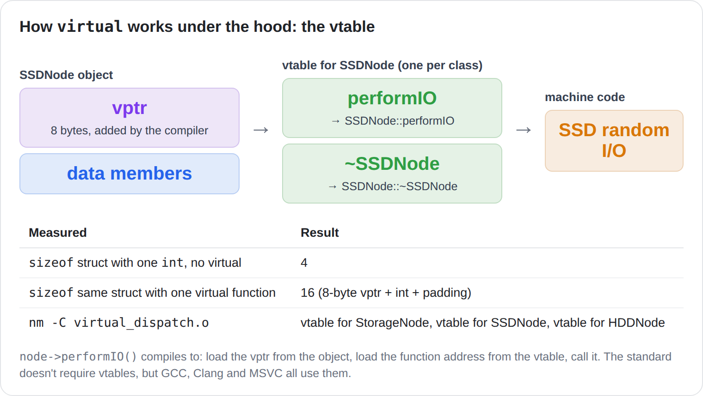

Both parts can be seen. The vptr costs 8 bytes per object:

```
sizeof(Plain) = 4, sizeof(Virtual) = 16
```

That's 4 bytes of `int`, an 8-byte vptr, and 4 bytes of padding to keep the struct aligned to 8 (Module 2). And `nm` shows the tables themselves in the object file:

```
0000000000000000 V vtable for StorageNode
0000000000000000 V vtable for HDDNode
0000000000000000 V vtable for SSDNode
```

## 4. Slicing

Polymorphism only works through pointers and references. Passing the same SSDNode three ways:

```cpp
void runThroughPointer(const StorageNode* node) { node->performIO(); }
void runThroughReference(const StorageNode& node) { node.performIO(); }
void runByValue(StorageNode node) { node.performIO(); }
```

```
SSD random I/O
SSD random I/O
generic storage I/O
```

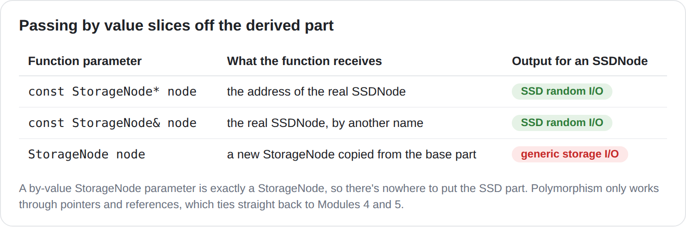

A `StorageNode` parameter is exactly a StorageNode, 12 bytes. Copying an SSDNode into it keeps the base part and slices off the rest, and the copy's vptr points at StorageNode's vtable. This is the reason Modules 4 and 5 matter so much here: a pointer or reference refers to the real object, so nothing gets cut off.

## 5. Abstract classes

There's no such thing as a "generic" storage node doing I/O, so `StorageNode::performIO()` shouldn't have a body at all:

```cpp
class StorageNode {
public:
    virtual void performIO() const = 0;
    virtual ~StorageNode() = default;
};

class NVMeNode : public StorageNode {
public:
    void performIO() const override { std::cout << "NVMe parallel queues I/O\n"; }
};
```

`= 0` makes it pure virtual, and a class with a pure virtual function is abstract. It can be used through pointers and references but can't be created on its own:

```
abstract.cpp:27:17: error: cannot declare variable 'generic' to be of abstract type 'StorageNode'
abstract.cpp:3:7: note:   because the following virtual functions are pure within 'StorageNode':
```

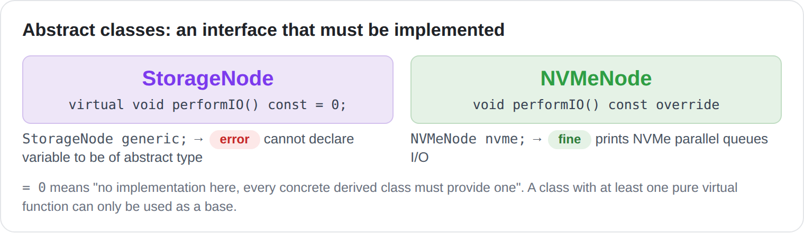

An abstract class with only pure virtual functions is how C++ writes an interface.

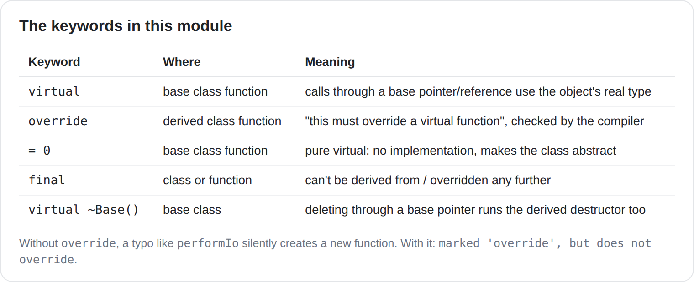

## 6. Virtual destructors

This one is broken on purpose. The base destructor isn't virtual, and SSDNode owns a 1 MiB write cache:

```cpp
class StorageNode {
public:
    virtual void performIO() const = 0;
    ~StorageNode() { std::cout << "  ~StorageNode\n"; }
};

class SSDNode : public StorageNode {
public:
    SSDNode() : writeCache(1024 * 1024) {}
    ~SSDNode() { std::cout << "  ~SSDNode (frees the 1 MiB write cache)\n"; }
    void performIO() const override {}
private:
    std::vector<char> writeCache;
};

StorageNode* node = new SSDNode();
delete node;
```

```
warning: deleting object of abstract class type 'StorageNode' which has non-virtual destructor will cause undefined behavior [-Wdelete-non-virtual-dtor]

delete through StorageNode*
  ~StorageNode
```

`~SSDNode` never runs, so the vector inside it is never destroyed and the 1 MiB is never freed. The destructor call is chosen from the pointer type, exactly like `describe()` in section 2. AddressSanitizer reports that the wrong-sized object was freed:

```
ERROR: AddressSanitizer: new-delete-type-mismatch
  object passed to delete has wrong type:
  size of the allocated type:   32 bytes;
  size of the deallocated type: 8 bytes.
```

Adding `virtual` to the base destructor (`-DFIXED`):

```
delete through StorageNode*
  ~SSDNode (frees the 1 MiB write cache)
  ~StorageNode
```

Derived first, then base: the reverse of construction order from Module 8.

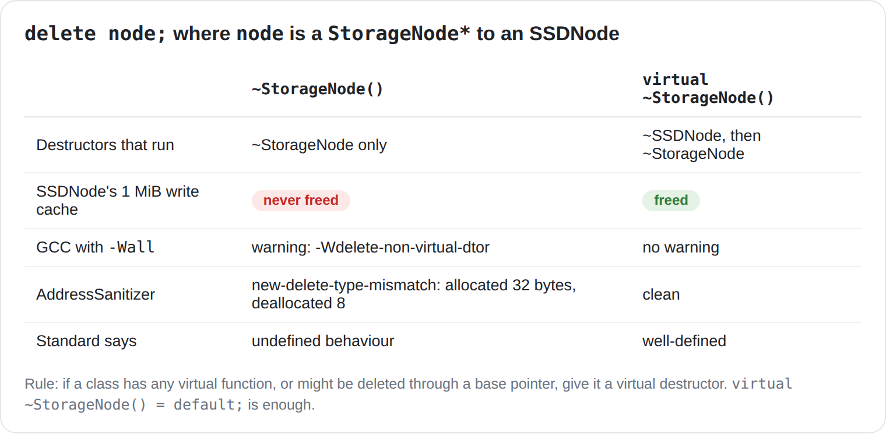

The rule I'm following: if a class has any virtual function, or might be deleted through a base pointer, it gets `virtual ~Base() = default;`.

## 7. Two kinds of polymorphism

Virtual functions are runtime polymorphism. Overloading (Module 6) and templates (Module 10) do the same job at compile time:

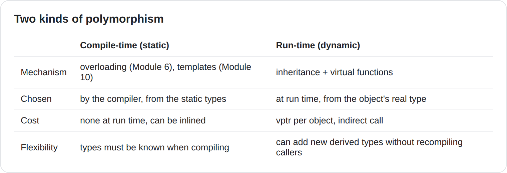

Virtual calls cost a vptr per object and an indirect call that usually can't be inlined. In return, new node types can be added without recompiling the code that uses `StorageNode*`. For most code that's worth it. For a hot loop over millions of objects, it's the first thing to measure.

---

Next: [Module 10, templates, namespaces and exceptions](../10-templates-namespaces-exceptions/).
