# Module 10: Templates, namespaces and exceptions

The last module of Phase 1 covers three features that every real C++ codebase uses together: templates, so the same logic works for many types; namespaces, so names from different parts of a large project don't collide; and exceptions, so an error can travel up from deep in the call stack to code that can deal with it. Each one connects back to an earlier module, so this post ends with a map of the whole phase.

All the code is in [`examples/`](examples/). `./run.sh` runs every example, lists template instantiations and namespaced symbols with `nm`, runs the uncaught-exception example, then rebuilds two examples with `-DSHOW_ERRORS` to show the compiler errors. The output is from GCC 11 on x86-64 Linux.

| File | What it shows | Run it |
|---|---|---|
| [`templates.cpp`](examples/templates.cpp) | Function templates, type deduction, explicit arguments | [Compiler Explorer](https://godbolt.org/z/1ETP9PGnY) |
| [`class_template.cpp`](examples/class_template.cpp) | A class template used with two types | [Compiler Explorer](https://godbolt.org/z/nn19oa43h) |
| [`namespaces.cpp`](examples/namespaces.cpp) | Namespaces, nested namespaces, `using` | [Compiler Explorer](https://godbolt.org/z/jsTvhK6Mc) |
| [`exceptions.cpp`](examples/exceptions.cpp) | `try` / `throw` / `catch`, propagation, stack unwinding | [Compiler Explorer](https://godbolt.org/z/8Yrzrqr5E) |
| [`uncaught.cpp`](examples/uncaught.cpp) | An exception with no handler (broken on purpose) | [Compiler Explorer](https://godbolt.org/z/sPsqbG4jW) |

---

## Part 1: Templates

### 1. The problem

Getting the first element of a vector, for three element types:

```cpp
int getFirst(const std::vector<int>& values) { return values[0]; }
double getFirst(const std::vector<double>& values) { return values[0]; }
std::string getFirst(const std::vector<std::string>& values) { return values[0]; }
```

Overloading (Module 6) makes this legal, but it's the same body three times, and a bug fix has to be made three times.

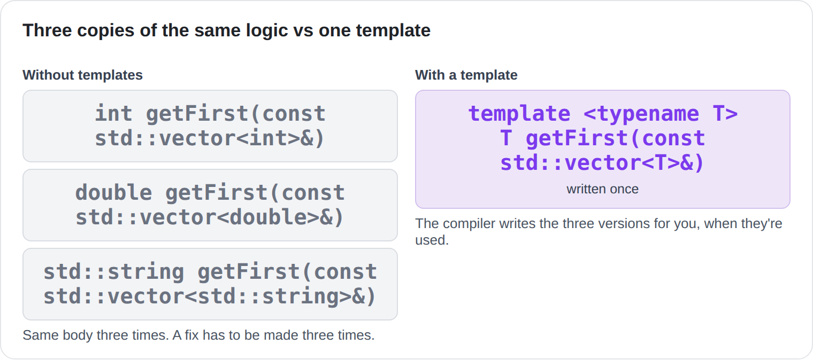

### 2. Function templates

```cpp
template <typename T>
T getFirst(const std::vector<T>& values) {
    return values[0];
}

template <typename T>
T findMaximum(T a, T b) {
    if (a > b) {
        return a;
    }
    return b;
}
```

`T` is a placeholder for a type. The compiler works out what it is from the arguments:

```
getFirst(ids)   = 7
getFirst(loads) = 0.75
getFirst(hosts) = fst-01
findMaximum(10, 20)     = 20
findMaximum(10.5, 20.5) = 20.5
findMaximum(string fst-01, string fst-09) = fst-09
findMaximum<double>(10, 20.5) = 20.5
```

The last line gives `T` explicitly. `10` is then converted to `double` like any normal function argument.

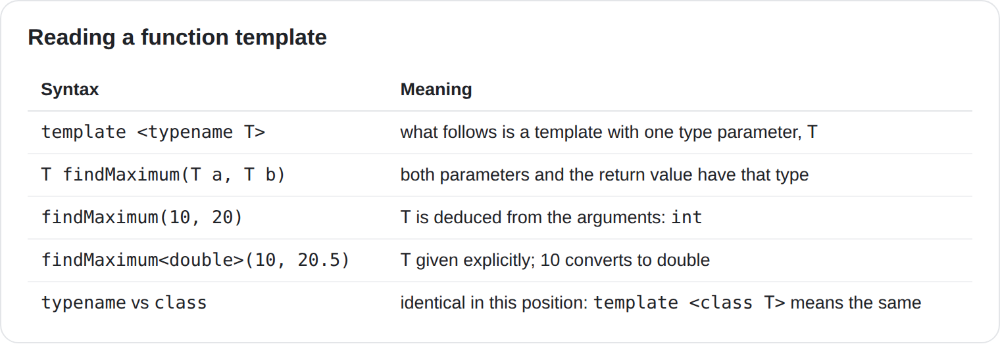

### 3. What the compiler actually generates

A template isn't code yet. It's a recipe, and the compiler writes a real function from it for each type it's used with. This is called instantiation, and `nm` shows the results in the object file:

```
W std::string findMaximum<std::string>(std::string, std::string)
W double findMaximum<double>(double, double)
W int findMaximum<int>(int, int)
W std::string getFirst<std::string>(std::vector<std::string> const&)
W double getFirst<double>(std::vector<double> const&)
W int getFirst<int>(std::vector<int> const&)
```

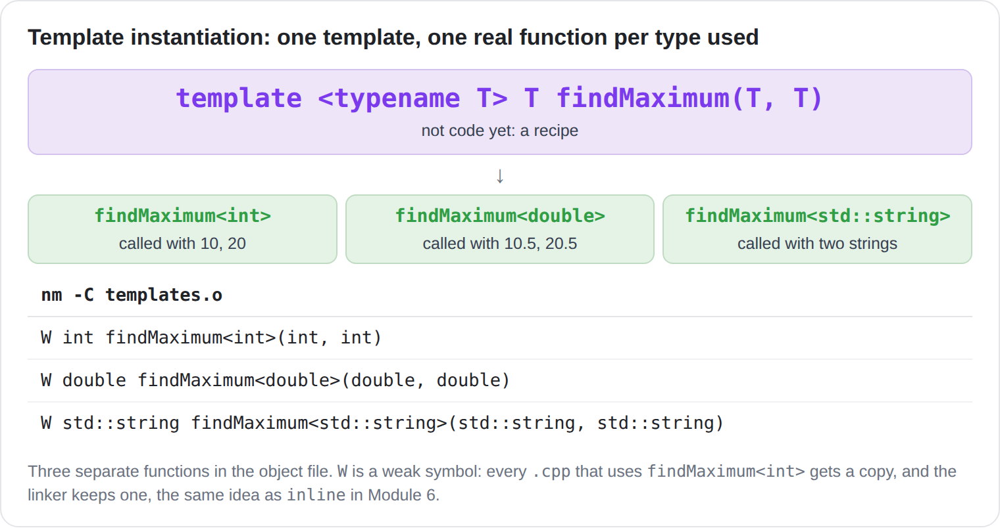

Six real functions, each with its own mangled name (Module 1). The `W` means weak: every `.cpp` that uses `findMaximum<int>` gets its own copy, and the linker keeps one. That's the same arrangement as `inline` in Module 6, and it's why templates are defined in headers instead of being declared there and defined in a `.cpp`.

### 4. A template still has to compile

Two calls that don't work, from `-DSHOW_ERRORS`:

```cpp
findMaximum(10, 20.5);
findMaximum(StorageNode{1}, StorageNode{2});
```

```
templates.cpp:38:16: note:   deduced conflicting types for parameter 'T' ('int' and 'double')
templates.cpp:12:11: error: no match for 'operator>' (operand types are 'StorageNode' and 'StorageNode')
```

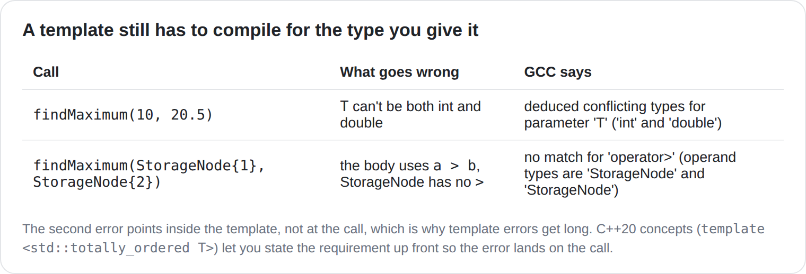

The second error points at line 12, inside the template, not at the call. The template body is only checked for real once it's instantiated with a type. With a large template that leads to very long errors, which is what C++20 concepts address: `template <std::totally_ordered T>` states the requirement up front, so the error lands on the call.

### 5. Class templates

```cpp
template <typename T>
class StorageContainer {
public:
    explicit StorageContainer(T value) : data(std::move(value)) {}
    const T& getData() const { return data; }
private:
    T data;
};

StorageContainer<int> intContainer(100);
StorageContainer<std::string> stringContainer("EOS");
```

```
100 EOS
sizeof(StorageContainer<int>)         = 4
sizeof(StorageContainer<std::string>) = 32
```

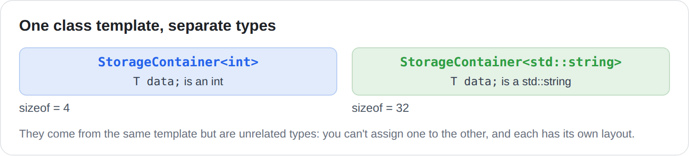

They come from the same template, but they're unrelated types with different sizes. One can't be assigned to the other.

I've been using class templates since Module 1 without writing one:

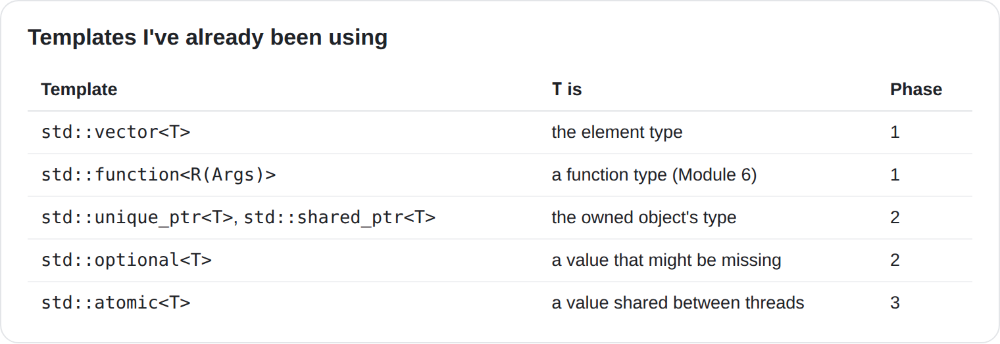

## Part 2: Namespaces

### 6. Same name, different scopes

A storage service and a metadata service in the same program can both have a `connect()`:

```cpp
namespace Storage {
    void connect() { std::cout << "connecting to storage\n"; }
}

namespace Metadata {
    void connect() { std::cout << "connecting to metadata\n"; }
}

namespace eos::fst {               // nested namespace, C++17 shorthand
    void connect() { std::cout << "connecting to an FST node\n"; }
}
```

`::` picks which one:

```cpp
Storage::connect();
Metadata::connect();
eos::fst::connect();
```

```
connecting to storage
connecting to metadata
connecting to an FST node
```

The linker doesn't know about namespaces, so they go into the mangled names:

```
T _ZN3eos3fst7connectEv
T _ZN7Storage7connectEv
T _ZN8Metadata7connectEv
```

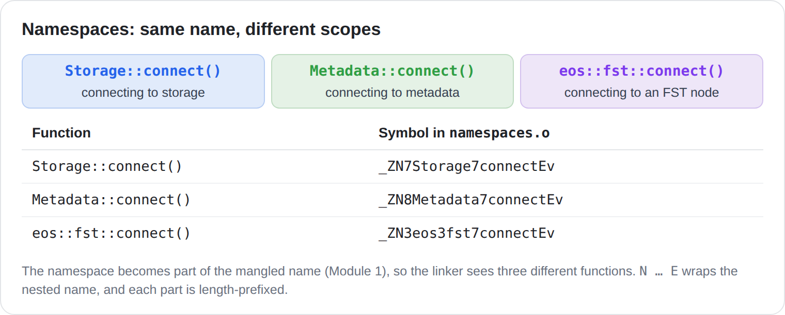

`N ... E` wraps a nested name, and each part is prefixed with its length: `3eos 3fst 7connect`.

### 7. using

`using Storage::connect;` brings in one name. `using namespace Storage;` brings in all of them, which is where conflicts come back:

```cpp
void tooMuchUsing() {
    using namespace Storage;
    using namespace Metadata;
    connect();
}
```

```
namespaces.cpp:19:12: error: call of overloaded 'connect()' is ambiguous
namespaces.cpp:8:10: note: candidate: 'void Metadata::connect()'
namespaces.cpp:4:10: note: candidate: 'void Storage::connect()'
```

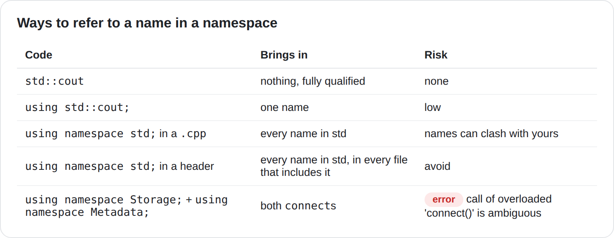

That's why I write `std::` everywhere in this repo, and why `using namespace std;` in a header is a bad idea: it spreads to every file that includes the header.

## Part 3: Exceptions

### 8. try, throw, catch

```cpp
int divide(int a, int b) {
    if (b == 0) {
        throw std::runtime_error("division by zero");
    }
    return a / b;
}

try {
    int result = divide(10, 0);
    std::cout << "  result: " << result << '\n';
} catch (const std::exception& e) {
    std::cout << "  error: " << e.what() << '\n';
}
```

```
  error: division by zero
```

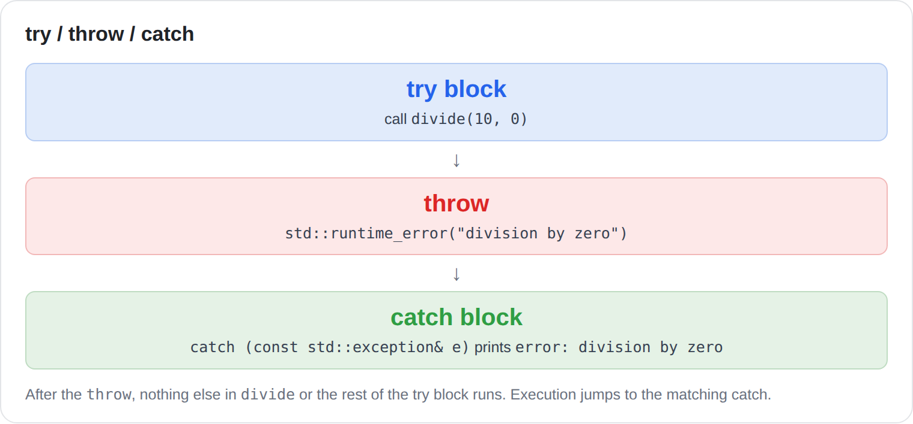

After `throw`, nothing else in `divide` runs, and neither does the rest of the `try` block. `result` is never printed.

`catch (const std::exception& e)` uses two things from earlier modules. `std::runtime_error` derives from `std::exception`, and `what()` is a virtual function (Module 9), so the handler gets the real message. And catching by `const&` (Module 5) avoids copying the exception, which would also slice it.

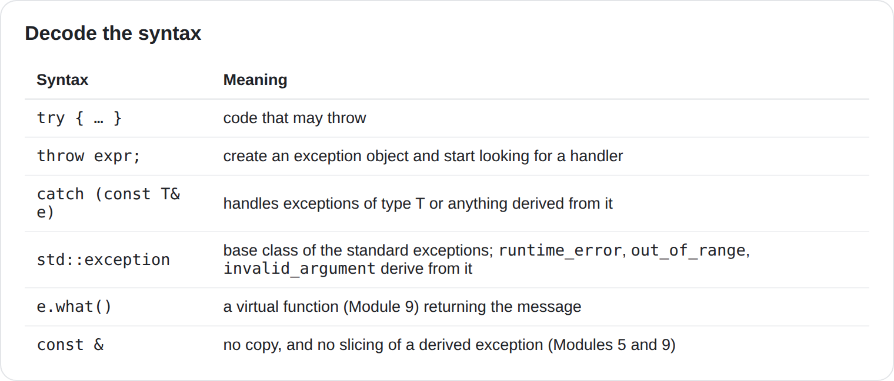

### 9. Propagation and stack unwinding

An exception doesn't have to be caught where it's thrown. Here `readFile` throws, `processFile` doesn't catch, and `main` does. Each function has a `Tracer` that prints from its destructor:

```cpp
void readFile() {
    Tracer t("readFile");
    throw std::runtime_error("disk read failed");
}

void processFile() {
    Tracer t("processFile");
    readFile();
}
```

```
  enter processFile
  enter readFile
  leave readFile (destructor)
  leave processFile (destructor)
  caught in main: disk read failed
```

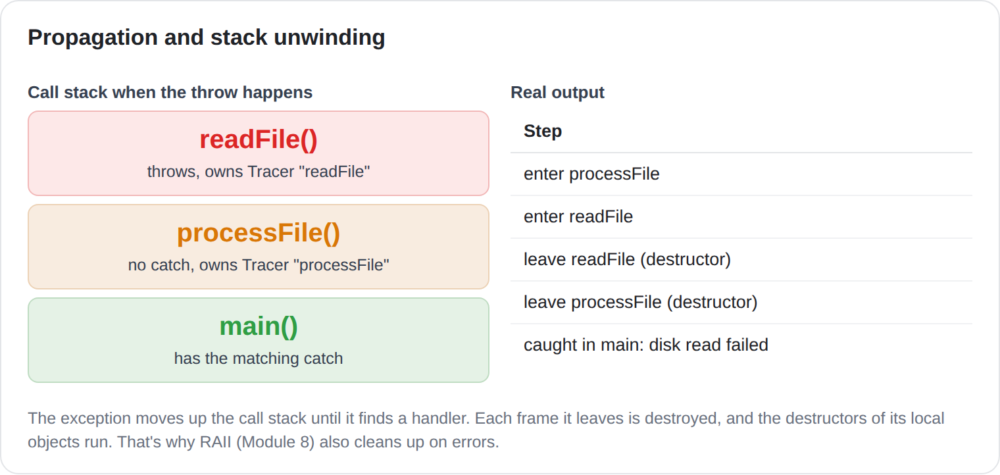

As the exception moves up the call stack, each function it leaves is ended early and the destructors of its local objects run. This is stack unwinding, and it's where Module 8 pays off: if `t` were a `StorageFile`, the file would be closed on the way out with no extra code. RAII makes cleanup on the error path automatic.

### 10. The first matching catch wins

```cpp
try {
    throw std::out_of_range("node id 99 doesn't exist");
} catch (const std::out_of_range& e) {
    std::cout << "  out_of_range: " << e.what() << '\n';
} catch (const std::exception& e) {
    std::cout << "  exception: " << e.what() << '\n';
}
```

```
  out_of_range: node id 99 doesn't exist
```

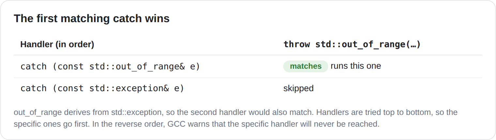

Handlers are tried top to bottom, and `out_of_range` derives from `std::exception`, so both match. Specific handlers go first. In the reverse order, GCC warns that the specific one can never be reached:

```
warning: exception of type 'std::out_of_range' will be caught by earlier handler [-Wexceptions]
```

### 11. No handler at all

```cpp
int main() {
    Tracer t;
    std::cout << "about to throw with no handler" << std::endl;
    throw std::runtime_error("disk read failed");
}
```

```
about to throw with no handler
terminate called after throwing an instance of 'std::runtime_error'
  what():  disk read failed
exit status: 134
```

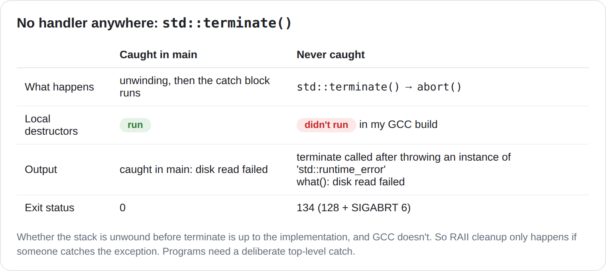

With no matching `catch`, the program calls `std::terminate()`, which calls `abort()`. Exit status 134 is 128 + 6, signal 6 being `SIGABRT` (Phase 4). `Tracer destructor` is never printed: whether the stack is unwound before terminating is up to the implementation, and GCC doesn't. So RAII cleanup only happens if someone catches the exception. I also had to use `std::endl` on the first line, because `abort()` doesn't flush `std::cout`, and without it the line never appeared.

### 12. Exceptions are one option

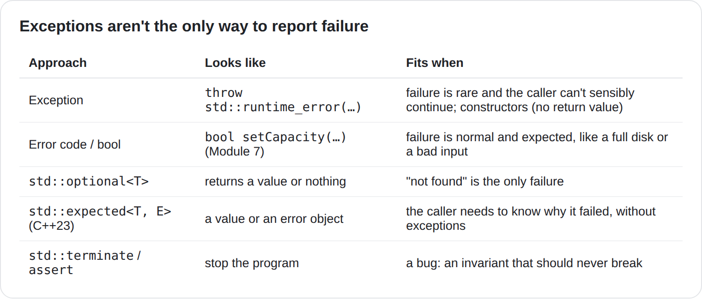

Exceptions fit failures that are rare and that the caller can't sensibly continue past, and they're the only way a constructor can report failure (the `StorageFile` in Module 8). For failures that happen all the time, like a full disk or bad user input, a return value is clearer. `std::optional` and `std::expected` are Phase 2 material.

---

## Phase 1, all together

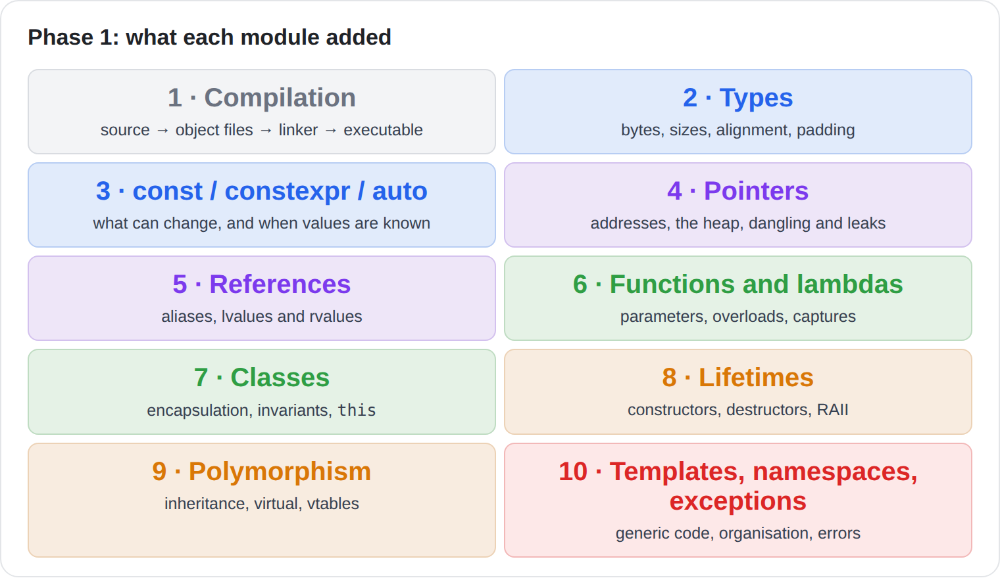

One small interface uses most of it:

```cpp
class StorageNode {
public:
    virtual void write(const std::vector<char>& data) = 0;
    virtual ~StorageNode() = default;
};

class SSDNode : public StorageNode {
public:
    void write(const std::vector<char>& data) override;
};
```

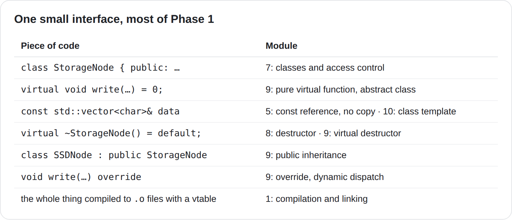

Phase 2 is next: memory management and modern C++. Stack and heap in depth, smart pointers, ownership, copy and move semantics, and the Rule of Zero and Five. Most of it is answering the question Module 8 left open: what should copying an object that owns something mean?
